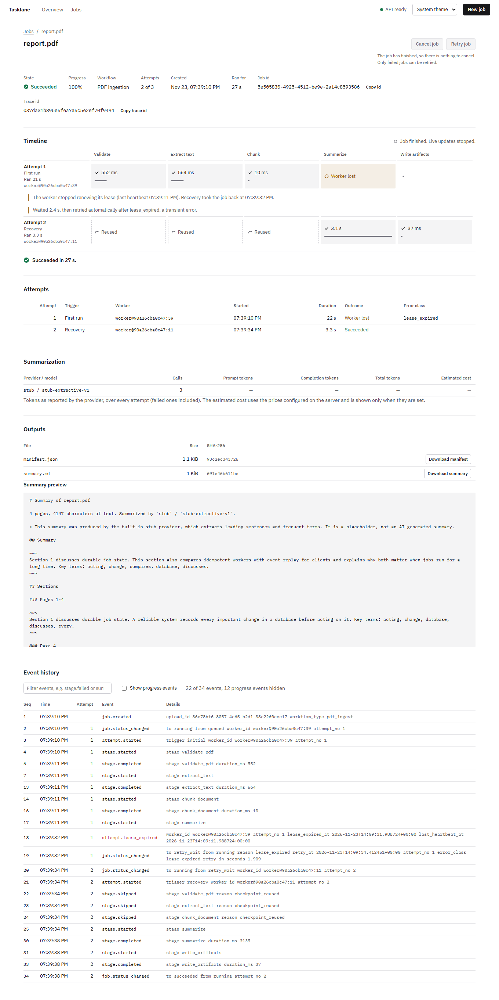
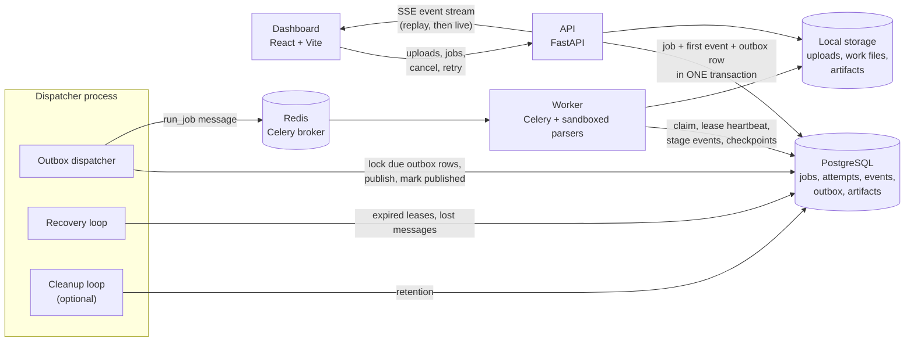

# Tasklane

Tasklane is a local-first service for running long AI processing jobs (PDF ingestion and
repository ZIP indexing) and watching them in an operations dashboard. Its focus is reliable
orchestration: job state lives in PostgreSQL, so jobs survive crashes, duplicate messages,
worker deaths and reconnecting browsers, and every retry, recovery and cancellation is recorded.



It runs on one machine with Docker Compose, needs no API key (a deterministic stub summarizer is
the default; an OpenAI-compatible provider is optional), and is single-user with no login. It is
a demonstration of durable job orchestration, not a hosted product: see
[Known limitations](#known-limitations).

## Architecture



One job's path: the API writes the job, its first event and an outbox row in one transaction
and returns. The dispatcher publishes the outbox row to Redis. A worker claims the job in
PostgreSQL (a duplicate message is dropped here), runs the stages while a heartbeat renews its
lease, and writes every step as a numbered event. The dashboard reads the same events through
the API, live. Redis is only the transport: if it loses a message, recovery sends another; if
the worker dies, recovery notices the expired lease.

## The reliability ideas, in plain language

- **Durable state.** PostgreSQL is the only source of truth for what the user sees. Redis and
  Celery never decide a job's status; if Redis is down, the API still shows every job.
- **The outbox.** "Create the job" and "send it to a worker" are one database transaction, so
  a job can never exist without its message, or the other way round. A separate process
  (the dispatcher) moves committed messages to Redis and retries until Redis accepts them.
- **Duplicate delivery and idempotency.** Messages can arrive twice (a crash between publishing
  and marking the row published, Redis redelivery). The worker's claim is a conditional update in
  PostgreSQL, so only one delivery starts an attempt; the others are dropped without writing
  anything. Stages are deterministic and write files atomically, so re-running one is harmless.
  On the client side, `POST /v1/jobs` needs an `Idempotency-Key`: the same key and request return
  the same job; the same key with a different request is a `409`. This is **at-least-once
  delivery with idempotent processing, not exactly-once execution.**
- **Leases and heartbeats.** A running attempt holds a 60-second lease that a heartbeat thread
  renews every 15 s. If the worker dies, the lease runs out and the recovery loop retries the job
  (or fails it clearly when the retry budget is used up). A worker that was only slow finds its
  attempt closed and stops without writing ("fencing").
- **Retries.** Only errors classified as transient (provider timeouts and outages, database or
  disk trouble, a lost worker) are retried, with exponential backoff and jitter, up to 3 attempts;
  input errors fail at once with a clear message. A retry resumes after the stages whose saved
  outputs still verify by size and SHA-256. A failed job can be retried by hand with a fresh budget.
- **Cancellation.** A queued job is cancelled at once (its pending message is deleted); a running
  job stops at the next stage boundary. It never depends on killing a process.
- **Event replay.** Every event has a per-job sequence number and is stored before it is sent.
  A browser that reconnects with `Last-Event-ID` gets exactly the events it missed, in order,
  then the live ones. Disconnecting never affects the job.
- **Retention.** A cleanup command deletes finished jobs, expired uploads and intermediate files
  past their retention period, never anything an unfinished job uses, and only after the rows
  that point at the files are gone.

The details, with the failure cases each mechanism covers: [docs/reliability.md](docs/reliability.md).

## Quickstart

Needs Docker Desktop (or Docker Engine with Compose v2). PowerShell on Windows; on macOS or Linux
use `cp` instead of `Copy-Item`.

```powershell
git clone <this repository> tasklane; cd tasklane
Copy-Item .env.example .env            # local settings; .env is gitignored
docker compose up --build -d           # PostgreSQL, Redis, migrations, API, dispatcher, worker, dashboard
curl.exe http://127.0.0.1:8000/health/ready
```

Then open the dashboard at **http://127.0.0.1:5173**, choose New job, and upload a PDF or a ZIP
of a source repository. To get sample files (a text PDF, a scanned one, a password-protected
one, a realistic repository ZIP, a zip bomb, a zip-slip archive, ...):

```powershell
docker compose run --rm -v "${env:USERPROFILE}\tasklane-demo:/out" api python -m devtools.pdf_samples /out
docker compose run --rm -v "${env:USERPROFILE}\tasklane-demo:/out" api python -m devtools.zip_samples /out
```

Every published port is bound to `127.0.0.1`. If 8000, 5173, 5432 or 6379 is taken, change
`API_HOST_PORT`, `FRONTEND_HOST_PORT`, `POSTGRES_HOST_PORT` or `REDIS_HOST_PORT` in `.env`.
`docker compose down` stops everything and keeps the data; `docker compose down -v` also deletes
the database, the uploaded files and any queued messages.

The API is documented in [docs/api.md](docs/api.md) (with PowerShell examples) and interactively
at http://127.0.0.1:8000/docs.

## See it recover from a crash

```powershell
powershell -ExecutionPolicy Bypass -File scripts\demo-recovery.ps1
```

The script submits a job, **kills the worker container in the middle of it**, starts a new
worker, and prints the job's stored events: the attempt that lost its worker
(`attempt.lease_expired`), the backoff, the second attempt reusing the checkpoints of the
stages that had finished, and the final `succeeded`. It takes about two minutes, mostly waiting
for the dead worker's 60-second lease to run out. Details: [docs/operations.md](docs/operations.md#failure-and-recovery-demo).

## Dashboard

| Screen | What it answers |
|---|---|
| **Overview** | Is the system healthy? Jobs per state, Redis, dispatcher and worker health, the oldest queued job's age, recent jobs. |
| **Jobs** | Job history, filtered by workflow and state (filters live in the URL), newest first. |
| **New job** | Upload with a progress bar, checked against the server's limits first. A retried submission reuses its idempotency key, so it can't create a second job. |
| **Job detail** | A live timeline (one row per attempt, one column per stage), the error and what you can do about it, attempts, downloads, the repository manifest, the full event history, the trace id. Cancel and Retry follow the server's `can_cancel` / `can_retry`. |

When the API can't be reached, the last data stays on screen marked "Not current". Light and dark
themes; an automated accessibility audit (axe, WCAG 2.2 AA) covers every screen in both.
Every screen and state: [docs/screenshots/](docs/screenshots/). Design: [DESIGN.md](DESIGN.md).

## Tests

Backend tests run inside Docker against real PostgreSQL and Redis (a separate `<db>_test`
database and Redis database 15; your data is never touched):

```powershell
docker compose run --rm api pytest                  # everything: unit, integration, end-to-end
docker compose run --rm api pytest -m "not e2e"     # skip the slower end-to-end tests (what CI runs)
docker compose run --rm api ruff check app tests migrations devtools
```

The end-to-end tests start real worker and dispatcher processes and, among other things, kill a
worker mid-job, deliver messages twice, and check that nothing reaches the real storage volume.

Dashboard tests, from `frontend/` with Node 24 (`npm ci` first):

```powershell
npm test                 # unit and component tests (Vitest)
npm run typecheck
```

### End-to-end tests

The Playwright suite (including the accessibility audit) drives a production build of the
dashboard against the real stack, which must run with the demo settings: fault injection on and
slower stub calls, so jobs can be watched and interrupted. Set them for one PowerShell session,
run the tests, then restore your own settings:

```powershell
$env:ENABLE_FAULT_INJECTION="true"; $env:STUB_DELAY_SECONDS="1"; $env:LEASE_SECONDS="20"; $env:PROVIDER_TIMEOUT_SECONDS="10"; $env:RECOVERY_INTERVAL_SECONDS="2"; $env:RETRY_BASE_SECONDS="2"
docker compose up -d
cd frontend; npx playwright install chromium; npm run e2e; cd ..
"ENABLE_FAULT_INJECTION","STUB_DELAY_SECONDS","LEASE_SECONDS","PROVIDER_TIMEOUT_SECONDS","RECOVERY_INTERVAL_SECONDS","RETRY_BASE_SECONDS" | ForEach-Object { Remove-Item "Env:$_" -ErrorAction SilentlyContinue }
docker compose up -d
```

These runs create jobs in the development database (remove finished ones with the cleanup:
[docs/operations.md](docs/operations.md#retention-and-cleanup)).

**CI** ([.github/workflows/ci.yml](.github/workflows/ci.yml)) runs lint, the backend unit and
integration tests (with PostgreSQL and Redis service containers), and the dashboard's unit tests
and type check on every push and pull request. The end-to-end suites (backend `e2e`, Playwright,
accessibility) are not in CI: they need the whole Compose stack, and run locally as above.

Which test proves which acceptance criterion: [docs/acceptance.md](docs/acceptance.md).

## Measured performance

Measured on one development machine (Windows 11 laptop, i5-12450H, Docker Desktop with 12 CPUs
and 7.6 GiB) with the stub summarizer and the default two worker processes; local measurements,
not production scale:

| | PDF job (4 pages) | Repository job (25 entries) |
|---|---|---|
| Worker time per job (median) | 1.33 s | 1.08 s |
| One job on an idle system, submit to finished | 2.30 s | 2.06 s |
| 40 jobs submitted at once: queue wait median / p95 | 11.7 s / 21.8 s | 11.8 s / 22.0 s |

With an instant summarizer, a batch is limited by the number of worker processes (40 jobs took
26.8 s). Command, inputs, settings and caveats: [docs/performance.md](docs/performance.md).

## Documentation

| Document | Contents |
|---|---|
| [PROJECT_BRIEF.md](PROJECT_BRIEF.md) | The original goals and acceptance criteria |
| [docs/architecture.md](docs/architecture.md) | Components, the lifecycle of a job, build phases, versions |
| [docs/api.md](docs/api.md) | Every route, error code and limit, with PowerShell examples |
| [docs/reliability.md](docs/reliability.md) | State machine, outbox, claim, leases, recovery, cancellation, replay, retries |
| [docs/security.md](docs/security.md) | Threat model: uploads, the parser sandbox, ZIP and PDF defenses, the dashboard, logs |
| [docs/observability.md](docs/observability.md) | One trace per job, metrics, logs, investigating a failed job |
| [docs/providers.md](docs/providers.md) | The optional OpenAI-compatible provider |
| [docs/operations.md](docs/operations.md) | Retention and cleanup, every time and size limit, the demo, the benchmark, the dependency audit |
| [docs/performance.md](docs/performance.md) | Benchmark results |
| [docs/acceptance.md](docs/acceptance.md) | Each acceptance criterion, its tests, and how to see it |
| [docs/decisions/](docs/decisions/) | Why each design decision was made, with the alternatives |
| [docs/walkthroughs/](docs/walkthroughs/) | Step-by-step manual checks, one per phase |
| [DESIGN.md](DESIGN.md) | Dashboard design |
| [CLAUDE.md](CLAUDE.md) | Maintainer guide: module boundaries, design rules, commands |

## Development

The `api`, `worker` and `dispatcher` containers run your local `backend/` code and restart when
a Python file changes; the `frontend` container runs Vite on your local `frontend/src`. Rebuild
only after changing dependencies (`backend/pyproject.toml`, `backend/uv.lock`,
`frontend/package.json`) or a Dockerfile: `docker compose up --build -d`. On Docker Desktop for
Windows, file changes are detected by polling (`WATCHFILES_FORCE_POLLING`, `TASKLANE_DEV_POLLING`).
Restarting the worker interrupts running jobs; recovery retries them once their lease expires.

Migrations live in `backend/migrations/versions/` and run in the one-shot `migrate` service
before the API starts (`docker compose run --rm migrate alembic check` compares them with the
models). Python dependencies are locked in `backend/uv.lock`, dashboard dependencies in
`frontend/package-lock.json` (exact versions), Docker images by tag.

## Known limitations

What Tasklane deliberately does not do, and why:

- **Single user, local only.** No authentication: anyone who can reach `127.0.0.1:8000` can
  upload. No cloud storage, Kubernetes or multi-machine deployment. The benchmark measures one
  development machine, not production scale.
- **At-least-once, not exactly-once.** A stage can run more than once (duplicate delivery, a
  retry after a lost worker); this is safe because stages are deterministic and idempotent, not
  because duplicates can't happen. With a real LLM provider, re-running a stage can produce a
  different summary (per-attempt artifact folders keep a late, fenced write from replacing the
  registered one).
- **Recovery takes a lease period.** A killed worker's job is retried only after its 60 s lease
  runs out. A worker machine that vanishes mid-transaction holds its row locks until PostgreSQL
  ends the idle session (60 s, `DB_IDLE_IN_TRANSACTION_TIMEOUT_SECONDS`).
- **Cancellation waits for the stage boundary.** A long stage (summarizing a 500-page PDF) runs
  to its end before the job becomes `cancelled`.
- **Scanned PDFs are not supported** (no OCR): they fail with `pdf_no_text`.
- **The real provider's limits were documented, not measured.** Whether a 1000-call repository
  fits the 900 s summarize limit with pacing depends on the provider; measuring it needs a paid
  key and sends data to a third party, so it was not done. With the stub nothing leaves the
  machine.
- **Secrets without a recognisable format** inside indexed files are sent to a real provider as
  they are (known formats and `.env`-style lines are replaced first). Files are not scanned for
  malware.
- **No extraction cap below the configured limits.** A repository job extracts allowlisted files
  up to `ZIP_MAX_TOTAL_BYTES` (500 MiB) even if the provider-call limit would later stop it; a
  byte cap before filtering would misfire on files the filter skips (minified, binary). The
  filter stage stops early once the text can't fit, and the work folder is deleted after
  `RETENTION_WORK_DAYS`.
- **A ZIP whose end record understates its entry count** falls back to the real count, or to the
  reader's memory and time limits (`zip_too_complex`) for millions of entries.
- **Cleanup is off by default** and deletes nothing until you run it or enable the loop; deleting
  rows lowers the `/metrics` counters (a counter reset for Prometheus). A manual retry after the
  upload was deleted fails with `input_unavailable`.
- **Test runs share the development database.** Playwright, the screenshot run and the benchmark
  create jobs there (the cleanup removes finished ones); there is no separate demo database.
- **Not in CI:** the end-to-end suites, which need the full Compose stack.
- **Jobs created before Phase 10** have no trace id.
