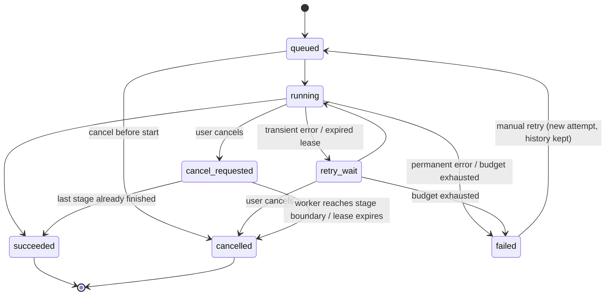

# Tasklane architecture (draft)

> **Status: PLANNED — nothing in this document is implemented yet.**
> This is a Phase 0 design draft. Each section will be revised as phases are built, and
> sections will be marked *implemented* only once the code and tests exist.

## 1. Goal

Tasklane accepts a PDF or a repository ZIP, processes it in named stages in the background, and
shows durable, inspectable job state (progress, events, attempts, errors, artifacts) in a dashboard.
The engineering focus is reliable orchestration: jobs survive crashes, duplicate deliveries do no
harm, transient failures retry with bounded backoff, and cancellation is cooperative.

Tasklane does **not** guarantee "exactly once" execution. It aims for *at-least-once delivery with
idempotent, repeat-safe stages*, so that a duplicate or interrupted run converges to the same result.

## 2. Components (planned)

| Component | Responsibility | Node.js analogy |
|---|---|---|
| **Dashboard** (React + TS + Vite) | Upload files, submit jobs, show history, detail, live events, queue health | A React SPA |
| **API** (FastAPI) | Validate requests, store uploads, create jobs, serve state, stream events (SSE) | Express app |
| **PostgreSQL** | Source of truth for uploads, jobs, attempts, events, artifacts, outbox | Like MongoDB here, but relational with transactions and constraints |
| **Outbox dispatcher** | Reads committed outbox rows and publishes Celery tasks | A small polling loop process |
| **Redis + Celery** | Transport work messages to workers | Redis + BullMQ |
| **Worker** (Celery) | Runs workflow stages, heartbeats its lease, writes events and artifacts | A BullMQ worker process |
| **Recovery loop** | Finds expired leases and requeues or fails the work. Runs in the dispatcher process, but is a separate module with separate tests so it can become its own service later | A cron-like sweeper |
| **Provider adapter** | `summarize(text, options) -> result`; stub (default) or optional LLM | A service interface with two implementations |
| **Local artifact storage** | Uploads and outputs in UUID-named directories on a Docker volume | `fs` writes to a mounted folder |

**Key rule:** Redis and Celery result state are *never* the source of truth for the UI. If Redis is
down, the API still returns each job's last durable state from PostgreSQL.

## 3. Lifecycle of one job (planned)

```mermaid
sequenceDiagram
    participant UI as Dashboard
    participant API as FastAPI
    participant DB as PostgreSQL
    participant D as Dispatcher
    participant Q as Redis/Celery
    participant W as Worker
    participant FS as Local storage

    UI->>API: POST /v1/uploads (file)
    API->>FS: write to uploads/{uuid}/ (generated path)
    API->>DB: insert upload (hash, size, status)
    API-->>UI: upload_id, sha256

    UI->>API: POST /v1/jobs (Idempotency-Key)
    API->>DB: ONE transaction: job (queued) + event #1 + outbox row
    API-->>UI: job (201, or existing job on same key + same request)

    loop every ~1s
        D->>DB: claim unpublished outbox rows (FOR UPDATE SKIP LOCKED)
        D->>Q: publish task(job_id)
        D->>DB: mark outbox row published
    end

    Q->>W: deliver task(job_id) (may happen more than once)
    W->>DB: lock job, check state, create attempt, set running + lease
    loop each stage
        W->>DB: check cancel flag; skip stage if already completed
        W->>FS: write outputs (temp file, then atomic rename)
        W->>DB: event + progress + heartbeat (extend lease)
    end
    W->>DB: artifacts + succeeded (or retry_wait / failed / cancelled)

    UI->>API: GET /v1/jobs/{id}/events (Last-Event-ID)
    API->>DB: read events with seq > Last-Event-ID, then poll for new ones
    API-->>UI: SSE stream
```

Step by step:

1. **Upload.** The API streams the file to `storage/uploads/{upload_uuid}/`, never using the
   user's filename in the path. It enforces size limits, checks extension and file signature
   ("magic bytes"), computes a SHA-256 hash, and records an `uploads` row.
2. **Create job.** The client sends `workflow_type`, `upload_id`, options, and an
   `Idempotency-Key` header. The API normalizes the request and hashes it. In **one transaction**
   it inserts the job (`queued`), the first event, and an outbox row. A unique constraint on the
   idempotency key makes concurrent duplicate submissions safe: same key + same request hash
   returns the existing job; same key + different hash returns `409 Conflict`.
3. **Dispatch.** The dispatcher claims unpublished outbox rows, publishes a Celery task containing
   only the `job_id`, and marks the row published. If it crashes between publishing and marking,
   the task is published again — which is acceptable because workers handle duplicates.
4. **Execute.** The worker locks the job row and decides whether to run. If the job is terminal,
   or another attempt holds a valid lease, the message is a duplicate and is dropped. Otherwise it
   creates a `job_attempts` row, sets `running`, and sets a lease expiry.
5. **Stages.** Between stages the worker checks for cancellation, records stage events and
   progress, and renews its lease (heartbeat). Stages are repeat-safe: outputs go to deterministic
   paths under `storage/artifacts/{job_id}/`, are written via temp-file-then-rename, and artifact
   rows are unique per `(job_id, artifact_type)`.
6. **Finish.** On success: artifacts recorded, `succeeded`. On a *transient* error (timeout,
   provider 5xx/429): `retry_wait` with a backoff delay, re-dispatched through a new outbox row
   that becomes available after the delay. On a *permanent* error (corrupt input, unsupported
   scanned PDF): `failed` with a safe error summary; tracebacks go to logs only.
7. **Recovery.** A periodic loop finds `running` attempts whose lease has expired (e.g. the worker
   was killed). It marks the attempt abandoned and either requeues the job (within its retry
   budget) or fails it with a clear reason.
8. **Events.** Every event is persisted with a per-job sequence number *before* it is streamed.
   The SSE endpoint replays events after `Last-Event-ID`, then polls for new ones. A client
   disconnect never cancels a job.

## 4. Job state machine (planned)

States: `queued`, `running`, `retry_wait`, `cancel_requested`, `succeeded`, `failed`, `cancelled`.
Terminal: `succeeded`, `failed`, `cancelled`.



**Cancel vs. completion race (decided):** if a user requests cancellation while the final stage is
already finishing, the job ends `succeeded`. The worker records an event explaining that
cancellation was requested but the job completed first.

The transition table lives in `backend/app/domain/` as pure Python with no database imports, so it
can be unit-tested exhaustively. Every transition is applied with a conditional update
(`... WHERE status = <expected>`) so two processes cannot both make the same transition.

## 5. Persistence model (planned)

| Table | Key columns | Notes |
|---|---|---|
| `uploads` | id, storage_path, original_filename (display only), sha256, size, mime, status, expires_at | Path is generated, never derived from the filename |
| `jobs` | id, workflow_type, status, current_stage, percent, upload_id, input_hash, idempotency_key (unique), request_hash, max_attempts, cancel_requested, error_summary, timestamps | `error_summary` is user-safe text only |
| `job_attempts` | job_id, attempt_no, worker_id, started_at, ended_at, lease_expires_at, outcome, error_class | Unique `(job_id, attempt_no)` |
| `job_events` | job_id, seq, type, created_at, payload (JSONB) | Unique `(job_id, seq)`; seq allocated under the job row lock |
| `artifacts` | job_id, artifact_type, storage_path, filename, size, mime, sha256, created_at | Unique `(job_id, artifact_type)` → duplicate runs upsert, not duplicate |
| `outbox` | id, job_id, payload, created_at, available_at, published_at, dispatch_attempts | `available_at` supports delayed retries |

Schema changes are made only through Alembic migrations.

## 6. Planned repository layout

```
backend/
  app/
    api/            # FastAPI routers, request/response schemas
    domain/         # state machine, error classes, pure rules
    db/             # SQLAlchemy models, session, repositories
    queue/          # Celery app, dispatcher, recovery loop, task entry points
    workflows/      # pdf and zip stage implementations
    providers/      # summarizer interface, stub, optional LLM
    observability/  # logging, tracing, metrics
  migrations/       # Alembic
  tests/            # unit/, integration/, e2e/
frontend/
  src/features/jobs/  src/features/dashboard/  src/lib/api/  src/components/
compose.yaml
.env.example
docs/  architecture.md  api.md  reliability.md  security.md
```

## 7. Versions

Backend versions below are **approved**; exact patch versions are verified against the package
indexes (not memory) when `uv.lock` is generated in Phase 1. **Frontend versions (React,
TypeScript, Vite) are not locked yet** — they are decided at the start of Phase 9.

| Tool | Planned | Why |
|---|---|---|
| Python | 3.13 | Mature wheel support across psycopg, Celery, OpenTelemetry; matches local install |
| FastAPI | latest 0.1xx at lock time | Pre-1.0 versioning; exact version fixed by the lock file |
| Pydantic | 2.12.x | Pydantic v2 is what current FastAPI uses |
| SQLAlchemy | 2.0.x | Stable 2.0-style API |
| Alembic | 1.16+ / latest 1.x | Migrations for SQLAlchemy |
| Postgres driver | psycopg 3.2+ (`psycopg[binary]`) | One driver for both sync (worker) and async use |
| Celery | 5.5.x | Current stable line with Redis broker support |
| Redis server | 7.4 | Long-proven with Celery/kombu |
| PostgreSQL | 17 | Mature; 18 is newer but offers nothing this project needs |
| Node | 24 LTS (tentative) | Active LTS; matches local install. Confirmed in Phase 9 |
| React / TypeScript / Vite | Decided in Phase 9 | Not locked yet |

Pinning: Python via `uv` (`pyproject.toml` + committed `uv.lock`); frontend via exact versions in
`package.json` + committed `package-lock.json` installed with `npm ci`; Docker images pinned by
specific tags (e.g. `postgres:17.x`, `redis:7.4.x`). Exact patch versions are recorded when the
lock files are first generated in Phase 1.

## 8. Build phases

| # | Phase | Notes |
|---|---|---|
| 0 | Planning | This document, `CLAUDE.md`, version proposal |
| 1 | Compose + FastAPI skeleton + health routes | Postgres, Redis, API containers on 127.0.0.1; `/health/live`, `/health/ready`; pytest harness; `.env.example`; basic structured logging |
| 2 | Migrations + state machine | Alembic; all six tables; pure state-machine module with exhaustive unit tests; event sequence allocation |
| 3 | Upload and job APIs with idempotency and outbox | Upload size/type/signature checks; `POST/GET /v1/jobs`; idempotency + 409; transactional outbox write |
| 4 | Dispatcher + Celery worker with one dummy stage | Outbox publishing; attempt creation; duplicate-delivery guard |
| 5 | PDF workflow + retries | Provider interface + **stub provider**; error classification; bounded backoff via delayed outbox rows |
| 6 | ZIP workflow + security | Path traversal, symlinks, zip bombs, file-count limits, file filtering, manifest + JSONL |
| 7 | Leases, recovery, cancellation, manual retry | Heartbeats; recovery loop; cooperative cancellation; `POST /cancel`, `POST /retry` |
| 8 | SSE with replay | `Last-Event-ID` replay, then live polling; paginated event history |
| 9 | Dashboard | Overview, new job, job detail, live events |
| 10 | Observability | OpenTelemetry traces/metrics, `/metrics`, no job IDs as metric labels |
| 11 | Optional LLM provider | OpenAI-compatible adapter behind config; timeouts; usage recording |
| 12 | Hardening, docs, demo | E2E tests, retention/cleanup command, measured timings, failure demo |

## 9. Decisions

- Tests run inside Docker by default, against real PostgreSQL (not SQLite), because row locking
  and constraint behavior differ between databases.
- The dispatcher process hosts two independent loops: `queue/dispatcher.py` (outbox publishing)
  and `queue/recovery.py` (expired-lease recovery), each with its own tests.
- `cancel_requested -> succeeded` is a legal transition (see §4).
- Local uploads and artifacts live under `storage/`, which is gitignored.

## 10. Open questions

None at the moment.
