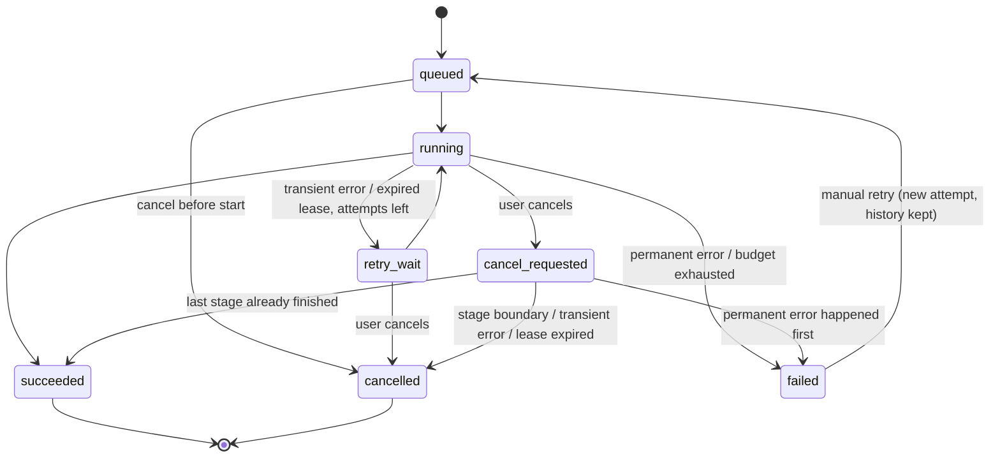

# Tasklane architecture (draft)

> **Status: partly implemented.** Implemented so far: the Compose stack with a one-shot `migrate`
> step, `/health/live` and `/health/ready`, JSON request logging (Phase 1), and the database
> schema, migrations, job state machine, and the database functions that apply status changes and
> append events (Phase 2), and the upload and job APIs: streaming uploads, idempotent job
> creation with the transactional outbox write, listing and detail (Phase 3), and the delivery
> pipeline: outbox dispatcher, Celery worker, claim with duplicate dropping, lease renewal on
> progress, and one placeholder stage (Phase 4), and the PDF workflow with the stub provider, the
> sandboxed parser, artifacts and their download route, error classification, automatic
> retries with backoff, and resume from verified checkpoints (Phase 5), and the repository ZIP
> workflow with its sandboxed ZIP reader, allowlist filtering, line chunking and three artifacts
> (Phase 6), and the worker heartbeat thread, the recovery loop (expired leases, lost messages),
> cancellation and manual retry (Phase 7), the SSE event stream with replay (Phase 8), and the
React dashboard with the overview and metadata routes (Phase 9). In the lifecycle below, steps 1–7 are implemented
> (step 5 runs the real stages of both workflows), and step 8 is planned. The HTTP API is documented in [api.md](api.md);
> delivery guarantees in [reliability.md](reliability.md); the threat model for untrusted
> uploads in [security.md](security.md).

## 1. Goal

Tasklane accepts a PDF or a repository ZIP, processes it in named stages in the background, and
shows durable, inspectable job state (progress, events, attempts, errors, artifacts) in a dashboard.
The engineering focus is reliable orchestration: jobs survive crashes, duplicate deliveries do no
harm, transient failures retry with bounded backoff, and cancellation is cooperative.

Tasklane does **not** guarantee "exactly once" execution. It aims for *at-least-once delivery with
idempotent, repeat-safe stages*, so that a duplicate or interrupted run converges to the same result.

## 2. Components (planned)

| Component | Responsibility | Node.js analogy |
|---|---|---|
| **Dashboard** (React + TS + Vite; implemented in Phase 9) | Upload files, submit jobs, show history, detail, the live timeline, queue health. Talks to the API only over HTTP, through the Vite proxy (one origin) | A React SPA |
| **API** (FastAPI) | Validate requests, store uploads, create jobs, serve state, stream events (SSE) | Express app |
| **PostgreSQL** | Source of truth for uploads, jobs, attempts, events, artifacts, outbox | Like MongoDB here, but relational with transactions and constraints |
| **Outbox dispatcher** | Reads committed outbox rows and publishes Celery tasks | A small polling loop process |
| **Redis + Celery** | Transport work messages to workers | Redis + BullMQ |
| **Worker** (Celery) | Runs workflow stages, heartbeats its lease, writes events and artifacts | A BullMQ worker process |
| **Recovery loop** | Finds expired leases and requeues or fails the work. Runs in the dispatcher process, but is a separate module with separate tests so it can become its own service later | A cron-like sweeper |
| **Provider adapter** | `summarize(text, options) -> result`; stub (default) or optional LLM | A service interface with two implementations |
| **Local artifact storage** | Uploads and outputs in UUID-named directories on a Docker volume | `fs` writes to a mounted folder |

**Key rule:** Redis and Celery result state are *never* the source of truth for the UI. If Redis is
down, the API still returns each job's last durable state from PostgreSQL.

## 3. Lifecycle of one job (planned)

```mermaid
sequenceDiagram
    participant UI as Dashboard
    participant API as FastAPI
    participant DB as PostgreSQL
    participant D as Dispatcher
    participant Q as Redis/Celery
    participant W as Worker
    participant FS as Local storage

    UI->>API: POST /v1/uploads (file)
    API->>FS: write to uploads/{uuid}/ (generated path)
    API->>DB: insert upload (hash, size, status)
    API-->>UI: upload_id, sha256

    UI->>API: POST /v1/jobs (Idempotency-Key)
    API->>DB: ONE transaction: job (queued) + event #1 + outbox row
    API-->>UI: job (201, or existing job on same key + same request)

    loop every ~1s
        D->>DB: claim unpublished outbox rows (FOR UPDATE SKIP LOCKED)
        D->>Q: publish task(job_id)
        D->>DB: mark outbox row published
    end

    Q->>W: deliver task(job_id) (may happen more than once)
    W->>DB: lock job, check state, create attempt, set running + lease
    loop each stage
        W->>DB: check cancel flag; skip stage if already completed
        W->>FS: write outputs (temp file, then atomic rename)
        W->>DB: event + progress + heartbeat (extend lease)
    end
    W->>DB: artifacts + succeeded (or retry_wait / failed / cancelled)

    UI->>API: GET /v1/jobs/{id}/events (Last-Event-ID or ?after=)
    loop every 0.5 s until the job is finished
        API->>DB: short read: events with seq > cursor
        API-->>UI: SSE: id/event/data per event (or a keepalive comment)
    end
    API-->>UI: stream.end, close
```

Step by step:

1. **Upload (implemented).** The request body is the raw file. The API commits an `uploads` row
   with status `receiving`, streams the body in chunks to a temporary file while hashing it and
   counting bytes against the size limit, checks the extension, declared type, and file
   signature ("magic bytes"), then renames the file atomically to
   `uploads/{upload_id}/source.{pdf|zip}` and marks the row `ready`. The user's filename is never
   used in a path. Any failure deletes the files and marks the row `rejected`.
2. **Create job (implemented).** The client sends `workflow_type`, `upload_id`, options, and an
   `Idempotency-Key` header. The API fingerprints the fields the client sent. In **one
   transaction** it inserts the job (`queued`) with `INSERT ... ON CONFLICT (idempotency_key) DO
   NOTHING`, the first event, and an outbox row. The unique index makes concurrent duplicate
   submissions safe: same key + same fingerprint returns the existing job (`200`,
   `Idempotent-Replayed: true`); same key + different fingerprint returns `409 Conflict`.
3. **Dispatch (implemented).** Every second, the dispatcher locks due unpublished outbox rows
   (`FOR UPDATE SKIP LOCKED`), publishes a Celery task containing only the `job_id`, and marks the
   rows published in the same transaction. If it crashes between publishing and committing, the
   task is published again, which is acceptable because workers drop duplicates. While Redis is
   down it records the error and backs off; jobs stay `queued`.
4. **Execute (implemented).** The worker claims the job with a conditional update: only a
   `queued` job, or a `retry_wait` job whose retry is due, moves to `running`, together with a new
   `job_attempts` row holding a 60 s lease. Any other state means the message is a duplicate or
   stale, and it is dropped without writing anything.
5. **Stages (implemented).** A heartbeat thread renews the attempt's lease every quarter lease,
   independent of stage code. Each progress report also renews it (as a fencing check), records
   progress and a `stage.progress` event, and fails if the attempt was closed by someone else
   (fencing); a fenced worker kills any parser child and writes nothing more. Before each stage
   the worker checks for a cancel request and stops there if it finds one (attempt `cancelled`,
   job `cancelled`). Stages are repeat-safe: outputs go to deterministic
   paths under `storage/artifacts/{job_id}/`, are written via temp-file-then-rename, and artifact
   rows are unique per `(job_id, artifact_type)`.
6. **Finish.** On success: artifacts recorded, `succeeded`. On a *transient* error (timeout,
   provider 5xx/429): `retry_wait` with a backoff delay, re-dispatched through a new outbox row
   that becomes available after the delay. On a *permanent* error (corrupt input, unsupported
   scanned PDF): `failed` with a safe error summary; tracebacks go to logs only.
7. **Recovery (implemented).** A loop in the dispatcher process (every 5 s) finds open attempts
   whose lease has expired (e.g. the worker was killed), closes them as `lease_expired`, and
   moves the job to `retry_wait` (with backoff and a delayed outbox row), `failed` ("Gave up after
   N attempts.") or `cancelled` (if cancellation was requested). It also re-queues claimable jobs
   whose message was evidently lost. See [reliability.md](reliability.md#leases-heartbeats-fencing-and-recovery-phase-7).
8. **Events (implemented).** Every event is persisted with a per-job sequence number *before*
   it is streamed. `GET /v1/jobs/{id}/events` runs one loop for replay and live: send every
   committed event with `seq` greater than the cursor (`Last-Event-ID`, else `?after=`), advance
   the cursor, sleep 0.5 s, repeat; then `stream.end` once the job is finished. Each read is a
   short transaction; an idle stream holds no database connection. A client disconnect stops the
   loop and never touches the job. `GET /v1/jobs/{id}/events/history` serves the same events as
   JSON pages. See [reliability.md](reliability.md#event-replay-phase-8) and `PHASE8_NOTES.md`.

## 4. Job state machine (implemented in Phase 2; used by workers from Phase 4)

States: `queued`, `running`, `retry_wait`, `cancel_requested`, `succeeded`, `failed`, `cancelled`.
Terminal: `succeeded`, `failed`, `cancelled`. "Terminal" means no automatic process (worker,
recovery, dispatcher) will ever move the job again; only a user's manual retry can reopen `failed`.



**Cancel vs. outcome race (decided):** a *definite* outcome reached before the worker's next
stage boundary wins over a pending cancel request: success ends `succeeded`, a permanent error
ends `failed`. A transient error (which would only lead to a retry) gives way to the cancel, and
the job ends `cancelled`. Whenever a definite outcome wins, a `job.cancel_superseded` event
explains it.

The full transition table, the reasoning behind each rule, how lost races are detected, and why
event numbers are per job are in [reliability.md](reliability.md). The code is in
`backend/app/domain/state_machine.py` (pure Python) and `backend/app/db/repositories/jobs.py`.

## 5. Persistence model (implemented in Phases 2–3)

The API writes `uploads`, `jobs`, `job_events` (`job.created`), and `outbox`. The dispatcher
reads and marks the outbox, and workers write `job_attempts`, progress, and stage events
(Phase 4), plus `artifacts` and `provider_calls` (Phase 5). Migration `0003` (Phase 5) added
`provider_calls`: one row per summarizer call (provider, model, latency, success, sizes, token
usage when the provider reports it), never the text itself. Migration `0004` added
`stage_checkpoints` (the files each finished stage wrote, for resuming retries) and
`ck_jobs_claimable_has_attempt_left`.
Column definitions are in `backend/app/db/models.py`; the reason for each constraint is in
[reliability.md](reliability.md#database-constraints).

Migration `0002` (Phase 3) made `uploads.sha256` and `uploads.size_bytes` nullable while an upload
is `receiving` (required once `ready`), added `uploads.rejection_reason`, and added three indexes on
`jobs` for newest-first keyset pagination: `(created_at DESC, id DESC)`, and the same prefixed by
`status` or `workflow_type`.

| Table | Key guarantees |
|---|---|
| `uploads` | Generated storage path (unique); a `receiving` status so half-written uploads can be found; size and hash required once `ready`; a reason required when `rejected` |
| `jobs` | Unique `idempotency_key`; attempt budget capped at 20; status-dependent fields (finish time, error, retry time, cancel time) always consistent; `last_event_seq` counter |
| `job_attempts` | Lease and heartbeat live here; **at most one open attempt per job** (partial unique index) |
| `job_events` | Primary key `(job_id, seq)`: each per-job number exists once, with no gaps |
| `artifacts` | Unique `(job_id, artifact_type)`: a repeated stage replaces, never duplicates |
| `outbox` | `available_at` for delayed retries; **at most one unpublished message per job** |

Deleting a job also deletes its attempts, events, artifacts and outbox rows; an upload can't be
deleted while a job references it. All timestamps are `timestamptz`. Lease checks compare against
the database clock (`now()`), never a container's clock.

**Migrations:** schema changes are made only through Alembic migrations in `backend/migrations/`.
The one-shot `migrate` Compose service runs `alembic upgrade head` and exits; the API waits for it
to succeed. Migrations are frozen snapshots (they spell out value lists instead of importing app
enums), and tests check that they match the models and the enums.

## 6. Repository layout

```
backend/
  app/
    api/            # FastAPI routers, request/response schemas, error mapping (implemented)
    services/       # use cases: coordinate db + storage + domain, own transactions (implemented)
    domain/         # state machine, upload and idempotency rules; pure Python (implemented)
    db/             # SQLAlchemy models, session, repositories (implemented)
    storage/        # local files: generated paths, temp writes, atomic renames (implemented)
    queue/          # Celery app, dispatcher, recovery loop, task entry points
    workflows/      # stage implementations (implemented): pdf/, repo/, the shared sandbox
    providers/      # summarizer interface, stub, optional LLM
    observability/  # logging, tracing, metrics
  migrations/       # Alembic
  tests/            # unit/, integration/, e2e/
frontend/           # (implemented in Phase 9)
  src/lib/api/        # typed fetch client, XHR upload with progress
  src/lib/live/       # the event stream: history + EventSource + gap fill + polling fallback
  src/features/       # dashboard/ (Overview), jobs/ (history, new job, detail, timeline)
  src/components/     # shell, status glyphs, SafeText (untrusted text), dialog
  e2e/                # Playwright: real-stack scenarios and the screenshot run
compose.yaml
.env.example
docs/  architecture.md  api.md  reliability.md  security.md
```

## 7. Versions

Frontend versions were locked in Phase 9 (checked against npm on 2026-11-14; reasons for each
library in `PHASE9_NOTES.md`): Node 24 LTS (`node:24.21.0-bookworm-slim` in Docker), React
19.3.1, TypeScript 7.0.2, Vite 8.3.8 (@vitejs/plugin-react 6.3.0), React Router 8.5.1, TanStack
Query 5.107.1, Base UI 1.9.0, IBM Plex Sans (variable) and IBM Plex Mono via @fontsource 5.3.0;
tests: Vitest 5.1.0, jsdom 31.0.1, Testing Library (react 16.3.3, dom 10.4.2, user-event 14.6.10,
jest-dom 7.0.1), Playwright 1.65.0.

Locked in Phase 1 (checked against PyPI and Docker Hub on 2026-11-02):

| Tool | Locked | Notes |
|---|---|---|
| Python | 3.13.18 (`python:3.13.18-slim`) | |
| uv | 0.13.6 | Package manager used in the Docker build |
| FastAPI | 0.162.0 (Starlette 1.10.0) | Pre-1.0, so pyproject restricts it to 0.162.x |
| Uvicorn | 0.54.0 (`[standard]`, watchfiles 1.3.0) | |
| Pydantic | 2.12.5 (pydantic-settings 2.16.2) | 2.14 exists; kept on the approved 2.12 line |
| SQLAlchemy | 2.0.55 | |
| psycopg | 3.3.6 (`[binary]`) | |
| redis (Python client) | 6.4.0 | Upgraded in Phase 4 (kombu 5.6 allows `<6.5`) |
| Celery | 5.6.3 (kombu 5.6.2, billiard 4.3.2) | Added in Phase 4; kombu held `<5.7` |
| PostgreSQL | 17.11 (`postgres:17.11-alpine`) | |
| Redis server | 7.4.12 (`redis:7.4.12-alpine`) | |
| pytest / httpx / ruff | 9.2.0 / 0.28.1 / 0.17.3 | Development only |
| Alembic | 1.20.1 | Added in Phase 2 (checked against PyPI on 2026-11-02) |
| Node | 24.21.0 (`node:24.21.0-bookworm-slim`) | Locked in Phase 9 |
| React / TypeScript / Vite | 19.3.1 / 7.0.2 / 8.3.8 | Locked in Phase 9 (full list above) |

Celery moved from the originally approved 5.5 line to 5.6 in Phase 4 (5.5 had no release since
June 2025, and its kombu capped the Redis client at 5.2.1). Celery 5.6 sets no upper bound on
kombu, so pyproject holds kombu on the 5.6 line it was released with.

Pinning: Python via `uv` (`pyproject.toml` + committed `uv.lock`); frontend via exact versions in
`package.json` + committed `package-lock.json` installed with `npm ci`; Docker images pinned by
specific tags.

### Health semantics (implemented in Phase 1)

- `/health/live`: always `200` while the process is running; touches no dependencies.
- `/health/ready`: runs the PostgreSQL and Redis checks concurrently and waits at most
  `DEPENDENCY_TIMEOUT_SECONDS` (default 2). Returns `503` only if PostgreSQL is unavailable.
  Errors are logged by type only (no driver messages, which may include hosts or users).
- Reconnection: the SQLAlchemy engine uses `pool_pre_ping`, so connections broken by a Postgres
  restart are detected and replaced on next use. redis-py drops broken connections and reconnects
  on the next command. Both are covered by integration tests that kill the API's server-side
  connections.

## 8. Build phases

| # | Phase | Notes |
|---|---|---|
| 0 | Planning | This document, `CLAUDE.md`, version proposal |
| 1 | Compose + FastAPI skeleton + health routes | Postgres, Redis, API containers on 127.0.0.1; `/health/live`, `/health/ready`; pytest harness; `.env.example`; basic structured logging |
| 2 | Migrations + state machine | Alembic; all six tables; pure state-machine module with exhaustive unit tests; event sequence allocation |
| 3 | Upload and job APIs with idempotency and outbox | Upload size/type/signature checks; `POST/GET /v1/jobs`; idempotency + 409; transactional outbox write |
| 4 | Dispatcher + Celery worker with one dummy stage | Outbox publishing; attempt creation; duplicate-delivery guard |
| 5 | PDF workflow + retries | **Part A:** stages, sandboxed parser and limits, provider interface + **stub provider**, artifacts and download route, `provider_calls`, lease `keep_alive`. **Part B:** transient vs permanent errors, bounded backoff with jitter via delayed outbox rows, attempt-budget CHECK, fault injection, stage checkpoints/resume (migration `0004`) |
| 6 | ZIP workflow + security | Path traversal, symlinks, zip bombs, file-count limits, file filtering, manifest + JSONL. Done: six stages, sandboxed ZIP reader shared with the PDF sandbox, allowlist filtering with skip reasons, line chunking, `summary.md` / `chunks.jsonl` / `manifest.json`, [security.md](security.md) |
| 7 | Leases, recovery, cancellation, manual retry | Done: heartbeat thread, recovery loop (expired leases, lost messages), cooperative cancellation at stage boundaries, `POST /cancel`, `POST /retry`, parent-death signal for parser children; see `PHASE7_NOTES.md` |
| 8 | SSE with replay | Done: one loop for replay and live (`Last-Event-ID` or `?after=`), `stream.end`, keepalives, stream limit and lifetime, write timeout, paginated event history, `devtools.sse_client`; see `PHASE8_NOTES.md` |
| 9 | Dashboard | Done: Overview, New job (XHR upload progress, limits from `GET /v1/meta`, idempotent retry), Jobs (URL filters, cursor paging), Job detail (live attempt × stage timeline, event history, attempts, artifacts, manifest viewer, server-driven Cancel/Retry); `GET /v1/overview`; Vite dev proxy; CSP; Playwright e2e and screenshots; see `DESIGN.md`, `PHASE9_NOTES.md` |
| 10 | Observability | OpenTelemetry traces/metrics, `/metrics`, no job IDs as metric labels |
| 11 | Optional LLM provider | OpenAI-compatible adapter behind config; timeouts; usage recording |
| 12 | Hardening, docs, demo | E2E tests, retention/cleanup command, measured timings, failure demo |

## 9. Decisions

- Tests run inside Docker by default, against real PostgreSQL (not SQLite), because row locking
  and constraint behavior differ between databases.
- The dispatcher process hosts two independent loops: `queue/dispatcher.py` (outbox publishing)
  and `queue/recovery.py` (expired leases and lost messages), each in its own thread with its own
  stop flag and its own tests.
- `cancel_requested -> succeeded` and `cancel_requested -> failed` are legal: a definite outcome
  wins over a pending cancel (see §4).
- Manual retry reopens `failed` jobs only, grants a fresh budget of 3 automatic attempts, is not
  offered for input errors, and is refused once it would push `max_attempts` past 20. It resumes
  from verified checkpoints, and its backoff counts attempts within the new run (Phase 7).
- Idempotency keys live as long as their job row (to be documented with the API in Phase 3).
- Integration tests run against `<POSTGRES_DB>_test`, never the development database.
- Local uploads and artifacts live under `storage/`, which is gitignored.
- The SSE stream is an async generator that polls the database with short reads (no
  LISTEN/NOTIFY, no thread per stream), and ends with `stream.end` when the job is finished
  (Phase 8; see `PHASE8_NOTES.md`).
- Names from inside an uploaded ZIP are data, never filesystem paths: extracted bytes go into one
  generated file (`work/{job_id}/files.bin`) at recorded offsets (Phase 6; see
  `PHASE6_NOTES.md`).

- The dashboard keeps no state of its own about jobs: it shows the API's job snapshot and derives
  the timeline from the stored events (ordered by `seq`), re-reading the job after events and
  after Cancel/Retry (never updating optimistically). The browser talks to one origin (the Vite
  dev/preview server proxies `/v1` and `/health`), so the API sends no CORS headers (Phase 9; see
  `PHASE9_NOTES.md`).

## 10. Open questions

None at the moment.
