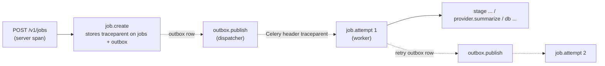

# Observability

Tasklane records three signals, all with OpenTelemetry where it fits:

| Signal | Where it goes by default | Optional |
|---|---|---|
| **Traces** (spans) | Created in every process, then dropped (no exporter). Their ids appear in logs and in `GET /v1/jobs/{id}` (`trace_id`). | OTLP/HTTP export (`OTEL_EXPORTER_OTLP_ENDPOINT`), e.g. to the local Jaeger of the `observability` Compose profile |
| **Metrics** | `GET /metrics` on the API (Prometheus text), `127.0.0.1:8000` only | The profile's Prometheus scrapes it every 15 s |
| **Logs** | stdout of each container, one JSON object per line, redacted | `docker compose logs` |

Nothing is sent anywhere unless you set `OTEL_EXPORTER_OTLP_ENDPOINT`, and nothing extra is
printed. Why each design choice was made (with the alternatives): `PHASE10_NOTES.md`.

## Investigating a failed job

Acceptance criterion #10: a reviewer can find the attempt history, the error, the output
artifacts, and the trace and log lines for a failed job.

1. **Dashboard** (http://127.0.0.1:5173): open the job (Jobs, filter *Failed*). The page shows
   the **timeline** (every attempt × stage), **Why it failed** (`error_class` and the safe
   message), the **Attempts** table (trigger, worker, duration, outcome and error class of each
   attempt), **Outputs** (artifacts exist only for succeeded jobs) and the **event history**.
   The same data is in `GET /v1/jobs/{id}` and `GET /v1/jobs/{id}/events/history`.
2. **Trace id**: the job facts show **Trace id** with *Copy trace id*. It is also `trace_id` in
   `GET /v1/jobs/{id}`.
3. **Trace viewer**: with the profile running and `TRACE_VIEWER_URL` set, click **Open trace**
   (or open `http://127.0.0.1:16686/trace/<trace_id>`). One trace holds the job's whole story:
   the `POST /v1/jobs` request, `job.create`, each `outbox.publish` by the dispatcher, each
   `job.attempt` with its `stage ...` spans, `provider.summarize` calls and database spans,
   recovery actions and manual retries. Failed spans are red and carry `error_class`.
4. **Logs**: filter every process's log lines by the trace id:

   ```powershell
   $TraceId = "<paste the trace id>"
   docker compose logs --no-log-prefix api dispatcher worker | Select-String $TraceId
   ```

   Every line written while working on the job carries `trace_id`, `span_id`, `job_id`, and
   (in the worker) `attempt_no` and `worker_id`. A traceback, if any, is in the `exception`
   field of the worker's `job attempt failed with an unexpected error` line (redacted; never
   stored in the database or shown by the API).

Without the viewer, steps 1, 2 and 4 work the same: the trace id is always recorded.

## Running the local viewers

```powershell
$env:OTEL_EXPORTER_OTLP_ENDPOINT = "http://jaeger:4318"
$env:TRACE_VIEWER_URL = "http://127.0.0.1:16686/trace/{trace_id}"
docker compose --profile observability up -d
```

- **Jaeger** `jaegertracing/jaeger:2.23.0` (all-in-one, in-memory): UI at
  http://127.0.0.1:16686. It receives OTLP on port 4318 inside the Compose network only.
  Search by service (`tasklane-api`, `tasklane-dispatcher`, `tasklane-worker`) or by tag
  (`job_id=<id>`).
- **Prometheus** `prom/prometheus:v3.16.0`: UI at http://127.0.0.1:9090, scraping
  `api:8000/metrics` (config: `observability/prometheus.yml`, 2 days of data in the
  `promdata` volume).

A plain `docker compose up` starts neither. Stopping them (`docker compose stop jaeger
prometheus`) changes nothing for jobs, requests or streams: exports run on a background thread
with a 2 s timeout, and a failing exporter logs at most one line per minute.

Turn export off again: `Remove-Item Env:OTEL_EXPORTER_OTLP_ENDPOINT, Env:TRACE_VIEWER_URL`
and `docker compose up -d` (recreates the backend containers without them).

## Configuration

| Variable | Default | Meaning |
|---|---|---|
| `OTEL_EXPORTER_OTLP_ENDPOINT` | unset | Base URL of an OTLP/HTTP receiver (`/v1/traces` is appended). Unset = no export. Traces only. |
| `OTEL_EXPORT_TIMEOUT_SECONDS` | 2 | Each export attempt gives up after this long (background thread). |
| `TRACE_VIEWER_URL` | unset | Link template with `{trace_id}`; returned by `GET /v1/meta` for the dashboard's *Open trace*. |
| `OTEL_SDK_DISABLED` | false | `true`: no tracing at all (no trace ids anywhere). |
| `TELEMETRY_SPAN_FILE` | unset | Tests/debugging: also append every finished span to this file as JSON lines. |
| `WORKER_PRESENCE_INTERVAL_SECONDS` | 5 | How often each worker process reports that it is alive. |

## Traces

### Propagation: one trace per job

The job's trace starts in the API and is carried through the database and Celery:



- `jobs.traceparent` (migration 0005): the W3C `traceparent` of `job.create`. `trace_id` in the
  API is read from it.
- `outbox.traceparent`: the span that **caused** the message: `job.create` (first run), the
  failed `job.attempt` (automatic retry), `recovery.lease_expired` / `recovery.lost_message`,
  or `job.manual_retry`.
- The dispatcher's `outbox.publish` span continues the row's traceparent and puts its own in the
  Celery message header `traceparent`; the worker's `job.attempt` continues that.
- Recovery actions, manual retries and cancellations have no stored "cause" inside the trace, so
  they continue `jobs.traceparent` (children of `job.create`). Manual retry and cancel spans
  also carry a **link** to the HTTP request span, which lives in its own trace.

**Parent-child, not links, for work that happens minutes later.** The OpenTelemetry messaging
conventions suggest links for asynchronous work, which would make every attempt its own trace.
We chose one trace per job because the point is a story you can open from one id: the trace view
then shows every attempt, retry and recovery in causal order. The cost: a trace stays "open" as
long as the job lives (a manual retry days later adds to it), and its root span (the request)
ends long before its children. That is valid OpenTelemetry and Jaeger shows it fine; a tail-
sampling collector (which waits a fixed time for a trace to complete) would split it, so don't
put one in front of this. Links are used where a span belongs to two stories (the retry request).

Every incoming HTTP request starts a new trace: an incoming `traceparent` header is ignored.
Duplicate Celery deliveries reuse the publish span's header, so a dropped duplicate shows up as a
short `job.attempt` span with `outcome=dropped` in the same trace.

### Spans

| Span | Kind | Process | Attributes |
|---|---|---|---|
| `<METHOD> <route template>` | SERVER | api | `http.request.method`, `http.route` (template), `http.response.status_code`, `job_id` (job routes) |
| `job.create` | INTERNAL | api | `workflow_type`, `job_id`, `outcome` (`created`/`replayed`) |
| `job.manual_retry`, `job.cancel` | INTERNAL | api | `job_id`, `workflow_type`, `outcome` (cancel: new status); link to the request span |
| `sse.stream` | INTERNAL | api | `job_id`, `resume_after`, `events_sent`, `last_seq`, `outcome` (`job_finished`, `disconnected`, `max_lifetime`, `job_not_found`) |
| `outbox.publish` | PRODUCER | dispatcher | `job_id`, `messaging.system`, `dispatch_attempt`, `outcome` (`published`/`failed`), `error.type` |
| `job.attempt` | CONSUMER | worker | `job_id`, `messaging.system`, `attempt_no`, `workflow_type`, `trigger`, `queue_wait_seconds`, `outcome` (`succeeded`, `failed`, `retry_scheduled`, `cancelled`, `dropped`, `fenced`), `drop_reason`, `error_class` |
| `stage <name>` | INTERNAL | worker | `job_id`, `attempt_no`, `workflow_type`, `stage`, `outcome` (`completed`, `reused`, `failed`, `stopped`), `error_class` |
| `provider.summarize` | CLIENT | worker | `job_id`, `attempt_no`, `workflow_type`, `stage`, `provider`, `model`, `purpose` (`chunk`/`combine`), `outcome`, `error_class`, `usage.*_tokens` (when reported) |
| `recovery.lease_expired` | INTERNAL | dispatcher | `job_id`, `attempt_no`, `outcome` (the job's new status) |
| `recovery.lost_message` | INTERNAL | dispatcher | `job_id`, `outcome=requeued` |
| `db <OPERATION>` | CLIENT | all | `db.system`, `db.operation`, `db.statement` (placeholders only), `error.type`, `db.response.status_code` (SQLSTATE) on errors |

Rules (a test scans every span every test produces, in-process and from the e2e processes,
against an attribute allowlist):

- Never document text, extracted text, file contents, archive file names, upload file names,
  paths, query strings, SQL parameter values, API keys or tokens.
- Exceptions are never recorded on spans (their messages and stack traces could contain any of
  the above). A failed span has status ERROR, no description, and `error_class`.
- Database spans exist only inside a traced operation (no orphan spans from idle polls), and the
  SSE stream's polls and the heartbeat's lease renewals create none (one span per stream
  connection, never per poll).
- Health checks and `/metrics` are not traced.
- FastAPI 0.162's built-in OpenTelemetry support is turned off (it records query strings and
  continues incoming `traceparent` headers); the API's middleware opens the server span.

## Metrics

`GET /metrics` returns Prometheus text (`text/plain; version=0.0.4`). Two sources:

- **From the database, at scrape time** (authoritative): jobs, attempts, events, provider calls,
  the outbox and the `worker_heartbeats` table. Exact, survives every restart, and covers every
  worker process, including Celery children that were recycled or killed (whose memory is gone,
  and was never reachable from the API anyway). Cost: a few aggregate queries per scrape,
  limited by a 5 s statement timeout.
- **Process-local OpenTelemetry instruments in the API**: event streams, which leave no database
  row. They reset when the API restarts (counter resets are normal for Prometheus).

Worker-only counters (fenced attempts, failed heartbeat beats, dead heartbeat threads) are kept
in each worker process's memory and saved in its `worker_heartbeats` row every few seconds, so
they are read from the database too.

Counters computed from rows are totals over the rows that exist; nothing deletes rows yet. Once
retention does (Phase 12), a total can drop, which Prometheus treats as a counter reset.

### Every metric

Counters end in `_total`, histograms add `_bucket{le=...}`, `_sum` and `_count`. Durations are
seconds.

| Metric | Type | Labels | Source | Meaning |
|---|---|---|---|---|
| `tasklane_jobs_created_total` | counter | `workflow_type` | db | Jobs created |
| `tasklane_jobs` | gauge | `status` | db | Jobs in each status now (every status present) |
| `tasklane_jobs_finished_total` | counter | `workflow_type`, `status` | db | Transitions into `succeeded`/`failed`/`cancelled` (a manually retried job can finish twice) |
| `tasklane_job_retries_total` | counter | `workflow_type`, `error_class` | db | Automatic retries scheduled (moves to `retry_wait`) |
| `tasklane_manual_retries_total` | counter | `workflow_type` | db | Manual retries |
| `tasklane_recoveries_total` | counter | `workflow_type`, `outcome` (`lease_expired`, `lost_message`) | db | Recovery actions |
| `tasklane_queue_wait_seconds` | histogram | `workflow_type` | db | Per attempt: job claimable (queued, or retry due) until claimed. Buckets 0.1 s – 1 h |
| `tasklane_workflow_runtime_seconds` | histogram | `workflow_type`, `outcome` (attempt outcome) | db | Per finished attempt: claim to end. Buckets 0.5 s – 1 h |
| `tasklane_stage_duration_seconds` | histogram | `workflow_type`, `stage` | db | Completed stage runs (reused checkpoints excluded). Buckets 50 ms – 15 min |
| `tasklane_provider_calls_total` | counter | `provider`, `model`, `outcome` (`success`/`failure`) | db | Summarization calls |
| `tasklane_provider_call_failures_total` | counter | `provider`, `model`, `error_class` | db | Failed calls by class |
| `tasklane_provider_call_duration_seconds` | histogram | `provider`, `model`, `outcome` | db | Call latency. Buckets 10 ms – 30 s |
| `tasklane_provider_prompt_tokens_total` | counter | `provider`, `model` | db | Prompt tokens reported by providers (never estimated; the stub reports none) |
| `tasklane_provider_completion_tokens_total` | counter | `provider`, `model` | db | Completion tokens reported by providers |
| `tasklane_oldest_queued_job_age_seconds` | gauge | – | db | Age of the oldest `queued` job (0 if none) |
| `tasklane_outbox_pending_messages` | gauge | – | db | Unpublished messages that are due or already failing |
| `tasklane_outbox_scheduled_messages` | gauge | – | db | Unpublished messages waiting for a later retry time |
| `tasklane_dispatch_failures_total` | counter | – | db | Failed publish attempts, counted once a message is published (while Redis is down, the rest of each batch counts as failed too); failures of still-unpublished messages show in `tasklane_outbox_pending_messages` |
| `tasklane_workers_alive` | gauge | – | db | Worker processes that reported within 3 presence intervals (15 s) |
| `tasklane_worker_fenced_attempts_total` | counter | – | db (worker rows) | Attempts stopped because recovery had closed them |
| `tasklane_worker_heartbeat_failures_total` | counter | – | db (worker rows) | Failed lease renewals by heartbeat threads (retried) |
| `tasklane_worker_heartbeat_thread_deaths_total` | counter | – | db (worker rows) | Heartbeat threads that died from an unexpected error |
| `tasklane_metrics_database_up` | gauge | – | – | 1 if this scrape could read the database, else 0 (the API-local metrics are still served) |
| `tasklane_sse_streams_open` | gauge | – | api process | Event streams open now |
| `tasklane_sse_streams_refused_total` | counter | – | api process | Streams refused with 503 `stream_limit_reached` |
| `tasklane_sse_streams_closed_total` | counter | `outcome` | api process | Streams closed: `disconnected`, `job_finished`, `max_lifetime`, `job_not_found` |
| `tasklane_sse_events_sent_total` | counter | – | api process | Events written to streams |
| `tasklane_sse_seq_gaps_total` | counter | – | api process | Missing event numbers noticed while streaming |

Not measurable by the server: browser-side stream reconnects and the dashboard's polling
fallback (they happen in the browser).

### Cardinality rules

Labels are bounded enums only: `workflow_type`, `status`, `stage`, `error_class`, `provider`,
`model`, `outcome` (plus Prometheus' own `le`). Never job, upload or attempt ids, worker ids,
pids, host names or paths: every distinct label value is a new time series forever. A test
(`tests/integration/test_metrics.py`) fails if any metric carries another label or a UUID-like
value. Ids belong in traces and logs.

### Worker availability

Each Celery child process (the ones that run jobs) writes its row in `worker_heartbeats` every
`WORKER_PRESENCE_INTERVAL_SECONDS` (5 s): `worker_id` (`worker@<host>:<pid>#<random>`, unique per
process instance because pids repeat after a restart), `last_seen_at` (database clock) and its
counters. A clean shutdown sets `stopped_at`, so the dashboard updates at once; a killed process
counts as gone after 15 s. `GET /v1/overview` returns `workers: {alive, last_seen_seconds}` and
the dashboard overview shows **No worker is running** when `alive` is 0. Celery's own
`inspect` (a round trip over Redis) is not used: the database is the source of truth and the
check works while Redis is down. Rows of old processes are kept (Phase 12 retention).

## Logs

One JSON object per line on stdout:

```json
{"ts": "...", "level": "INFO", "logger": "app.services.execution", "message": "job claimed",
 "trace_id": "4bf9...", "span_id": "00f0...", "job_id": "…", "attempt_no": 2,
 "worker_id": "worker@3f2c:11", "queue_wait_seconds": 0.731}
```

- `request_id` on API lines; `trace_id`/`span_id` whenever a span is active; `job_id`,
  `attempt_no`, `worker_id` bound for a whole attempt (so lines from deep inside a stage carry
  them), `job_id` for the dispatcher's and recovery's per-job lines.
- **Redaction** (`app/observability/redaction.py`) runs on every string of every line, the
  traceback included: private key blocks, credentials in URLs (`postgresql://[REDACTED]@db`),
  `Bearer`/`Basic` values, known token formats (`sk-...`, AWS, GitHub, GitLab, Slack, Google
  keys, JWTs), `name=value` pairs whose name looks sensitive (password, secret, token, api_key,
  authorization, credential, cookie, session id), the literal value of the database password
  and of every environment variable whose name looks sensitive (8 characters or longer), and
  any `extra=` field whose key looks sensitive (`api_key`, `accessToken`, ...). Every pattern
  runs in linear time and strings over 64 KiB are cut first (request paths are attacker-
  controlled; a test times hostile inputs). Details: [security.md](security.md).
- Document text, extracted text and archive file contents are never logged (an e2e test runs a
  PDF and a ZIP containing a marker string and checks no log line or span contains it).
- The OpenTelemetry SDK's own warnings (a stopped collector) are limited to one line per minute
  per message.
