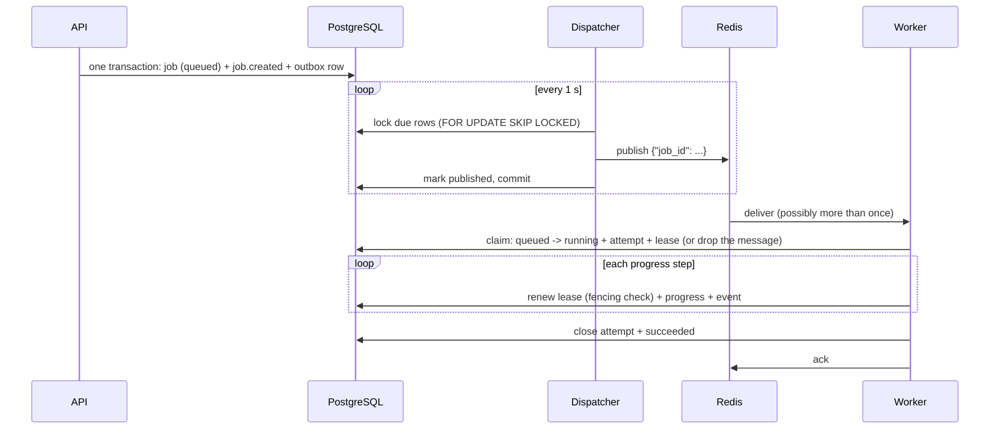

# Reliability design

This document explains how Tasklane keeps job state correct when several processes touch the same
job at once, and what each database constraint protects.

> **Status (Phase 8):** implemented and tested: the state machine, the schema and its
> constraints, conditional status changes and per-job events (Phase 2), idempotent job creation
> with the outbox write (Phase 3), the delivery pipeline: dispatcher, Celery worker, claim,
> duplicate handling, progress with lease renewal and fencing (Phase 4), error classification,
> automatic retries with backoff, and resume from verified checkpoints (Phase 5), and the
> heartbeat thread, the recovery loop (expired leases, lost messages), cancellation, and manual
> retry (Phase 7), and event replay over SSE (Phase 8). See
> [What is still not covered](#what-is-still-not-covered) and
> [what replay does not guarantee](#what-replay-does-not-guarantee).

Tasklane does **not** promise "exactly once" execution. Messages may be delivered more than once,
and a worker may die halfway through a job. The goal is that duplicates and interruptions can't
corrupt state: every change is either applied once or detectably rejected.

## Job state machine

Code: `backend/app/domain/state_machine.py` (pure Python, no database or framework imports; a test
enforces that).

| From | To | Trigger |
|---|---|---|
| `queued` | `running` | A worker claims the job |
| `queued` | `cancelled` | User cancels before any worker has it |
| `running` | `succeeded` | All stages finished |
| `running` | `retry_wait` | Transient error, or expired lease, with attempts left |
| `running` | `failed` | Permanent error, or attempts exhausted |
| `running` | `cancel_requested` | User cancels |
| `retry_wait` | `running` | A worker claims the due retry |
| `retry_wait` | `cancelled` | User cancels (no worker involved) |
| `cancel_requested` | `cancelled` | Worker reaches a stage boundary, hits a transient error, or its lease expires |
| `cancel_requested` | `succeeded` | Last stage finished first |
| `cancel_requested` | `failed` | Permanent error happened first |
| `failed` | `queued` | Manual retry |

Every other pair (37 of the 49 possible) is illegal and raises `IllegalTransitionError` before any
SQL runs. Repeating an action, such as cancelling an already-cancelled job, is a no-op rather than a
transition: `cancel_decision()` returns "no change" and the API reports the current state.

### Rules and why

- **Queued or waiting jobs are cancelled directly.** No worker holds them, so there is nothing to
  wait for. If their queue message is still delivered later, the worker's claim (a conditional
  update from `queued`/`retry_wait`) matches nothing and the message is dropped.
- **A definite outcome beats a pending cancel; a retryable one doesn't.** If the job succeeds or
  fails permanently before the worker reaches its next stage boundary, that real outcome is kept
  (`succeeded` / `failed`) and a `job.cancel_superseded` event explains it. Hiding a real error
  behind "cancelled" would make failures harder to debug. A transient error would only lead to a
  retry the user no longer wants, so the job ends `cancelled`.
- **Expired lease** (the worker stopped heartbeating): `retry_wait` if attempts remain, otherwise
  `failed` with error class `lease_expired`; `cancelled` if cancellation had been requested.
- **"Terminal" means no automatic process moves the job again.** `succeeded` and `cancelled` are
  final. `failed` can be reopened only by a user's manual retry, which moves the *same* job back to
  `queued`. The next claim creates a new attempt with the next attempt number; all earlier attempts
  and events are kept.
- **A manual retry starts a clean run.** It clears the finish time, error, stage, progress, and
  any old cancel request (a CHECK forbids a cancel timestamp on an active job, so a leftover
  request can't make the new run cancel itself). A success also clears errors left by earlier
  failed attempts. The history stays in `job_attempts` and `job_events`.

### Manual retry

`can_manual_retry(status, error_class, attempt_count)` returns whether a retry is allowed, why not,
and the new budget:

- Only `failed` jobs can be retried.
- Not offered when the failure was caused by the input (`INPUT_ERROR_CLASSES` in
  `app/domain/errors.py`: a corrupt, encrypted or scanned PDF, an unsafe ZIP, ...): rerunning
  would fail the same way. Upload a corrected file and create a new job instead.
- A retry grants a fresh budget of 3 automatic attempts: `max_attempts = attempt_count + 3`.
  `transition_job` refuses a `failed -> queued` change that doesn't set `max_attempts`, so a job
  can't be requeued with no attempts left to run.
- The database caps `max_attempts` at 20. A retry that would exceed the cap is refused with reason
  `retry_limit_reached`, so the constraint is never what stops it. A test checks every
  `attempt_count` from 1 to 20 against the real database.

The API route, `POST /v1/jobs/{id}/retry` (Phase 7), runs in one transaction: lock the job row,
ask `can_manual_retry`, then `failed -> queued` with the new `max_attempts` and
`manual_retry_count + 1`, a `job.manual_retry` event (previous error class, attempt count, new
budget), and a new outbox row. A refusal is `409 job_not_retryable` with `details.reason`
(`not_failed`, `input_error`, `retry_limit_reached`). Two retry requests at once queue one run:
the second waits for the first's row lock, then sees `queued` and gets `409 not_failed`.

- **The backoff restarts with the run.** Backoff is computed from the attempt number *within the
  current run* (`run_attempt_no`: `attempt_no - (max_attempts - 3)`), so the first automatic
  retry after a manual retry waits 2.5–5 s again, not the 20–40 s that lifetime attempt 4 would
  give.
- **It resumes from verified checkpoints.** The input is unchanged and every checkpoint is
  re-verified (stage version, fingerprint of settings and upstream files, size and SHA-256 of each
  output) before it is reused, so the stages that already finished are skipped and anything
  doubtful runs again. If the failure was caused by a bug that has since been fixed in a stage,
  that fix comes with a new `stage_version`, which invalidates the checkpoint.

## Conditional updates: how lost races are detected

Code: `transition_job()` in `backend/app/db/repositories/jobs.py`.

A status change is a single statement:

```sql
UPDATE jobs
SET status = :to, updated_at = now(), last_event_seq = last_event_seq + 1, ...
WHERE id = :id AND status = :from
RETURNING last_event_seq
```

Postgres locks the row while updating it. If two processes try the same change, the second waits
for the first to commit, then re-checks its `WHERE` clause against the new row. The status no
longer matches, so it updates zero rows and `RETURNING` gives back nothing. (In MongoDB terms:
`findOneAndUpdate({_id, status: "queued"}, ...)` returning `null`.) If the committed status
already differs when the second process arrives, Postgres skips the row without waiting at all.

This relies on Postgres's default isolation level, READ COMMITTED. (Under REPEATABLE READ or
SERIALIZABLE, the losing update raises a serialization error instead of matching zero rows.)

When nothing comes back, `transition_job` re-reads the latest committed status and returns
`TransitionResult(applied=False, status=<current>)`, or raises `JobNotFoundError` if the job doesn't
exist. That status may change again a moment later, so callers treat it as the basis for a new
decision, never as final. Callers decide what losing means:

- A worker whose claim lost treats its message as a duplicate and drops it.
- An API cancel that lost re-evaluates from the status it now sees (for example, `running` →
  `cancel_requested`).

Integration tests make the race deterministic: connection A updates without committing,
connection B starts the same update in a thread, the test waits until Postgres reports B as
*blocked by A's process* (`pg_blocking_pids`), then A commits. B must lose, and exactly one status
event must exist.

`transition_job` also keeps the status-dependent fields consistent: it sets `finished_at` on
terminal states, sets `started_at` once, records `cancel_requested_at`, requires `retry_at` for
`retry_wait`, `error_summary` for `failed` and `max_attempts` for a manual retry, resets the run
on a manual retry (see above), and only accepts a fixed list of other columns. A test runs every
one of the 12 legal transitions against the real schema.

Because these functions use plain SQL rather than the ORM, they flush pending ORM changes first
(so a just-added job is visible to the `UPDATE`) and mark any cached `Job` object stale afterwards,
on both the applied and the lost path. They never commit; the caller does.

## Per-job event sequence numbers

Each event's number comes from `jobs.last_event_seq`, incremented by an `UPDATE` on the job row.
That `UPDATE` holds the row lock until the transaction commits, so for any one job, numbers become
visible in the same order they were handed out.

**Why not a table-wide auto-increment?** An auto-increment number is assigned when a row is
*inserted*, but other readers see the row only when it is *committed*, and those happen in
different orders:

1. Transaction A inserts an event and gets number 101; transaction B gets 102.
2. B commits first.
3. An SSE client reads up to 102, disconnects, and reconnects with `Last-Event-ID: 102`.
4. A commits event 101.
5. Replay asks for "events after 102", so **101 is never delivered**.

With per-job numbers, event 2 can't even be created until event 1 is committed, so no reader can see
2 without 1. A rollback also undoes the counter increment, so numbers are always 1, 2, 3… with no
gaps, and a client that receives 7 right after 5 knows it missed 6. `Last-Event-ID` is per job
stream anyway, so "event 7 of this job" is the natural meaning.

**Cost:** event writes for one job take turns, which is fine because one worker runs a job at a
time. Different jobs never block each other (tested with a 1-second lock timeout). Transactions that
write events must stay short, since they hold the job's row lock until commit.

**Order by `seq`, never by time.** `created_at` uses Postgres's `now()`, which is the start time of
the *transaction*, so an event can carry an earlier timestamp than the one before it. The SSE
stream and the history route order by `seq` only (see [Event replay](#event-replay-phase-8)).

## Database constraints

Every constraint has an integration test proving it rejects the bad data it targets, identified by
constraint name; two-way ("if and only if") checks are tested in both directions. A meta-test
fails if a constraint exists without a test.

The migrations and the models are checked against each other strictly: a test builds one database
from the migrations and another directly from the models, then compares Postgres's own definition
of every constraint (including CHECK bodies), every index (including partial-index conditions),
and every column (type, nullability, default, identity). Alembic's built-in comparison alone
misses CHECK bodies and partial-index conditions.

| Constraint | Protects |
|---|---|
| `uq_jobs_idempotency_key` | Idempotent submission: two requests with the same key can't both create a job |
| `uq_job_attempts_one_open_per_job` (partial unique index) | At most one live attempt per job, even if a message is delivered twice |
| `pk_job_events` `(job_id, seq)` | Each per-job event number exists exactly once |
| `uq_artifacts_job_id_artifact_type` | A repeated stage replaces its artifact instead of duplicating it |
| `uq_outbox_one_pending_per_job` (partial unique index) | A job can't be queued twice at once by recovery, automatic retry, and manual retry |
| `ck_jobs_attempt_budget` | No more attempts than the budget; budget capped at 20 |
| `ck_jobs_claimable_has_attempt_left` | A `queued` or `retry_wait` job always has an attempt left, so a claim's `attempt_count + 1` can never break the budget (a job out of attempts must be `failed`) |
| `pk_stage_checkpoints` `(job_id, stage)`, `ck_stage_checkpoints_*` | One checkpoint per stage per job, with a well-formed fingerprint and at least one output file to verify |
| `ck_jobs_finished_iff_terminal` | A job looks finished exactly when it has a finish time |
| `ck_jobs_failed_has_error` | Every failed job carries a non-empty explanation (uses `coalesce`, because a bare `char_length(NULL) > 0` is NULL and CHECK treats NULL as a pass) |
| `ck_jobs_retry_wait_has_retry_at` | A waiting job always knows when it will run again |
| `ck_jobs_cancel_has_timestamp` | A record of when cancellation was requested |
| `ck_jobs_no_cancel_while_active` | A queued, waiting, or running job never carries a leftover cancel request |
| `ck_job_attempts_ended_iff_outcome` | An attempt is open, or closed with an outcome; never in between |
| `ck_job_attempts_lease_after_start`, `..._heartbeat_after_start` | Lease and heartbeat times are sane |
| `fk_jobs_upload_id_uploads` (RESTRICT) | A job's input record can't be deleted while the job exists |
| `uq_uploads_storage_path`, `uq_artifacts_storage_path` | Two rows never point at the same file |
| `ck_uploads_deleted_consistent` | An upload marked deleted has a deletion time, and vice versa |
| `ck_*_status`, `ck_*_kind`, `ck_*_type`, `ck_*_trigger`, `ck_*_outcome`, `ck_outbox_task_name` | Only known values are stored. The lists are frozen in the migration; a test checks them against the Python enums |
| `ck_*_sha256_format`, `ck_jobs_request_hash_format` | Hashes are 64 lowercase hex characters |
| `ck_*_payload_object`, `ck_jobs_options_object` | JSON columns hold objects, never bare values |
| Other range/length checks | Progress 0–100, positive sizes and sequence numbers, bounded key and filename lengths |

The lease and heartbeat live on `job_attempts`, not `jobs`, so frequent heartbeats never compete
with cancel requests or event writes for the job row. Recovery closes an expired attempt; if its
worker was only slow, its next heartbeat (`... WHERE id = :mine AND ended_at IS NULL`) matches
nothing, telling it to stop without writing anything.

## Delivery: outbox → dispatcher → Redis → worker



### The dispatcher

One pass is one database transaction: lock up to 50 due rows (`published_at IS NULL AND
available_at <= now()`, oldest first) with `FOR UPDATE SKIP LOCKED`, publish each to Redis while
holding the locks, mark them published, commit. `SKIP LOCKED` makes a second dispatcher skip
locked rows instead of waiting, so two dispatchers never publish the same row (tested with two
dispatchers running at once). It polls every second; LISTEN/NOTIFY isn't used because delayed
retries (`available_at` in the future) need polling anyway and notifications are lost while the
dispatcher is disconnected.

| Crash point | Message in Redis? | Outbox row | What happens |
|---|---|---|---|
| After locking, before publishing | No | Unchanged (rolled back) | Next pass publishes it. Nothing lost. |
| After publishing, before commit | Yes | Still unpublished | Next pass publishes it **again**: a duplicate, which the worker drops (tested). |
| After commit | Yes | Published | Normal. |
| Redis accepted the message, then lost it before saving | No | Published | Job stays `queued` until recovery notices (after `LOST_MESSAGE_GRACE_SECONDS`) and re-queues it. Redis append-only persistence (flushed every second) makes this unlikely. |

**Redis unavailable:** the failed row and the rest of its batch get `dispatch_attempts + 1`,
`last_dispatch_error` (the error *type*), and `available_at` pushed back by 1 s, 2 s, 4 s, ... up to
60 s, measured from the moment of failure. The loop backs off as well and never gives up; jobs stay
`queued` and visible through the API and go out when Redis returns. The dispatcher's Celery app
doesn't retry connections internally, but a failed publish can still take a few seconds (the
connect timeout doesn't cover DNS, which is slow for a stopped container), during which the pass
holds its row locks. Workers, in contrast, keep reconnecting for as long as Redis is down.

### Celery settings

| Setting | Value | Why |
|---|---|---|
| Serialization | JSON only | Pickle can run code while unpacking; messages carry only `{"job_id": ...}`. |
| Result backend | none | PostgreSQL is the source of truth. |
| `task_acks_late` | on | A message is acknowledged after the task, so a worker dying before it claims the job doesn't lose the message. Safe because the claim drops duplicates. |
| `task_reject_on_worker_lost` | on | A killed worker process puts its message back instead of acknowledging it (tested: the redelivered message is then dropped because the job is already `running`). |
| `worker_prefetch_multiplier` | 1 | Each process reserves one message at a time, so a busy or dying process can't hoard messages. |
| Redis `visibility_timeout` | 900 s | An unacknowledged message is redelivered after 15 minutes. Long jobs see harmless duplicate deliveries; a message whose worker died before claiming waits at most this long. Must exceed the lease (checked at startup). |
| `task_time_limit` | 3600 s | Last-resort kill; the job's lease then expires and recovery retries or fails it. |

The **lease** (60 s, in the database) protects work that has been *claimed*; the **visibility
timeout** (in Redis) protects messages that were *received but not yet claimed*. Duplicates from
either are dropped by the claim.

### The claim

One transaction: read the job with `SELECT ... FOR UPDATE` (so a concurrent claimer waits, then
sees `running`); if it is `queued`, or `retry_wait` with `retry_at <= now()`, move it to `running`
with a conditional update (`attempt_count + 1`), insert an attempt row with
`lease_expires_at = now() + 60 s`, and append `attempt.started`. The unique index "one open attempt
per job" backs this up.

**If the database is unavailable** while a task runs, the task asks Celery to deliver the message
again after a backoff (1 s doubling to 60 s, indefinitely) instead of failing. With late acks, a
task that raises is still acknowledged, so failing would lose the message and leave the job
`queued` forever. If the claim had already committed before the error, the redelivered message is
simply dropped as a duplicate.

Every other case means the message is a duplicate or stale, and it is **dropped without writing
anything** (logged as `message dropped` with a reason):

| The job is... | Reason |
|---|---|
| `running` / `cancel_requested` | Another attempt holds it (a duplicate). |
| `succeeded` / `failed` / `cancelled` | Stale, including a job cancelled while queued. |
| `retry_wait` with `retry_at` in the future | An early duplicate: it must not cut the backoff short. |
| Changed between our read and our update | Lost the race to another worker. |
| Missing | Deleted. |

## Leases, heartbeats, fencing, and recovery (Phase 7)

The full story of what happens when a worker disappears. Code: `app/services/heartbeat.py`,
`app/services/execution.py`, `app/queue/recovery.py`. Design notes with the alternatives that
were considered: `PHASE7_NOTES.md`.

### The lease

When a worker claims a job it opens an *attempt* with a lease: `lease_expires_at = now() +
LEASE_SECONDS` (60 s), measured on the database clock. The lease is the worker's claim to the job.
While it is renewed, nobody else touches the job; once it runs out, the worker is presumed dead.

### The heartbeat

A background thread per running attempt (`Heartbeat`) renews the lease every
`HEARTBEAT_INTERVAL_SECONDS` (default a quarter of the lease, 15 s; at most a third, so two missed
beats still leave it alive), whatever the stage is doing. Each beat is one short transaction on
its own pooled connection: `UPDATE job_attempts SET heartbeat_at = now(), lease_expires_at =
now() + lease WHERE id = :attempt AND ended_at IS NULL`.

- Started inside the task, after the claim committed, in the forked Celery worker process (so no
  thread ever crosses a fork); stopped and joined in a `with` block however the attempt ends
  (success, failure, fencing, cancel, or an exception leaving `run()`). Tested for all of them.
- A daemon thread: when the process is killed, it dies with it, and the lease runs out.
- A failed beat (database briefly down) is logged and retried at the next interval.
- If the thread itself dies from a bug, it logs it and sets `died`; stage writes still renew the
  lease, and a long silent stage would at worst be recovered and retried. Never two owners.
- Stage writes (progress, provider calls, artifacts) still renew the lease in their own
  transaction. That is not needed for liveness any more; it is the fencing check that makes each
  write conditional on still owning the attempt.

The price of an independent heartbeat: a stage stuck forever would be kept alive forever. Every
stage has its own time limit (parser deadlines, `stage_timeout`), and the Celery hard time limit
(`CELERY_TASK_TIME_LIMIT_SECONDS`) kills the whole process as the last resort, after which the
lease expires normally.

### Fencing

Only *closing* an attempt takes the job away from a worker; a renewal never checks the expiry
time. So the question "who owns the job?" has one answer: whoever's attempt is still open.

When a renewal (heartbeat or stage write) matches no row, the attempt was closed by someone else:
the worker is **fenced out**. The heartbeat sets a `fenced` flag; the execution service checks it
before every write and at each stage boundary, and `keep_alive()` (now a flag check, no database)
raises once it is set. The parser sandbox calls `keep_alive()` about once a second while waiting,
so a running PDF or ZIP child is killed within about a second of the flag being set. The flag is
set by the next heartbeat after the attempt was closed (15 s by default), or by the worker's next
write, whichever comes first. A worker that can't reach the database at all can't learn it was
fenced: its stage runs on (to the parser deadline at most) and every write it tries fails. After that the worker writes
nothing: no events, no progress, no artifacts, no status change (finishing also starts with a
conditional close of the attempt, which fails).

**Files.** A fenced worker may still finish one file write that was already under way (a
`work/` or `artifacts/` file, replaced atomically). That is harmless today because every stage's
output is deterministic: the new attempt writes byte-for-byte the same content to the same path,
readers always see a complete file (atomic rename), and checkpoints are verified by size and
SHA-256 before reuse. Artifacts are registered in the database only in the successful attempt's
finishing transaction, which a fenced worker can never commit. A non-deterministic provider
(Phase 11) breaks the "same content" argument and must write per-attempt files.

### Recovery

`app/queue/recovery.py`, run in the dispatcher process in its own thread with its own stop flag
(`RECOVERY_INTERVAL_SECONDS`, default 5 s). No Celery or HTTP imports (a test enforces it).
Each job is handled in its own short transaction.

**Expired leases.** `SELECT ... FROM job_attempts WHERE ended_at IS NULL AND lease_expires_at <
now() ORDER BY lease_expires_at LIMIT 1 FOR UPDATE SKIP LOCKED`, then:

1. close the attempt as `lease_expired` and append `attempt.lease_expired` (worker id, last
   heartbeat, expiry time);
2. lock the job and apply `status_after_lease_expired`:
   - `running` with attempts left → `retry_wait`, with the usual backoff; `retry_at` and the
     outbox row's `available_at` come from one `now()` in this transaction (`enqueue_retry`),
     exactly like a transient failure in the worker. The next attempt's trigger is `recovery`;
   - `running` with the budget used → `failed`, error class `lease_expired`, summary "... Gave
     up after N attempts.";
   - `cancel_requested` → `cancelled` (nobody is left to finish it, and the user wanted it
     stopped).

**Lock order.** Recovery locks the attempt, then the job, exactly like a worker reporting
progress or finishing. The claim locks the job first but never an existing open attempt (a job
with an open attempt is not claimable), so no cycle exists. SKIP LOCKED means recovery skips an
attempt the worker is renewing right now (that worker is evidently alive). If the worker renews
first, the lease is no longer expired; if recovery closes first, the worker is fenced. A test
runs a worker's finish and a recovery pass at the same instant, repeatedly, for both success and
failure: never a deadlock, always exactly one of them in charge.

**Lost messages.** A job that should be running soon but has no message on its way: `queued`,
or `retry_wait` whose `retry_at` passed more than `LOST_MESSAGE_GRACE_SECONDS` (300 s) ago; not
changed within the grace period; no open attempt; and no outbox row that is unpublished or was
published within the grace period. Recovery adds a new outbox row and appends `job.requeued`
(`reason: lost_message`, previous status, when the last message went out). Causes: Redis losing a
message, a worker killed after receiving a message but before claiming it (Redis would redeliver
it only after the 900 s visibility timeout), a task failing before its claim committed. A
requeue that turns out unnecessary is a harmless duplicate.

**Safe twice and concurrently.** SKIP LOCKED hands different rows to concurrent passes; once a
row is handled it no longer matches (closed attempt; fresh outbox row). Tests run two loops at
once over 20 expired attempts and 10 lost jobs: each is handled exactly once.

### Cancellation

`POST /v1/jobs/{id}/cancel` locks the job row and applies `cancel_decision()`:

- `queued` / `retry_wait` → `cancelled` at once, and the job's *unpublished* outbox row is
  deleted in the same transaction. A message already in Redis is dropped by the claim (the job
  is not claimable). This covers cancelling during retry backoff.
- `running` → `cancel_requested`. Before each stage the worker reads the job's status; on
  `cancel_requested` it closes the attempt as `cancelled` and moves the job to `cancelled`
  (`before_stage` in the event), in one transaction, attempt then job.
- `cancel_requested` or finished → 200 with the job unchanged (repeated cancels are no-ops).

The earlier rules still hold: success or a permanent failure that happens before the next stage
boundary wins (`job.cancel_superseded`); a transient failure during `cancel_requested` ends
`cancelled`; an expired lease during `cancel_requested` ends `cancelled`. Races are tested
deterministically by holding one side's transaction open until the other is provably waiting
for its lock.

### Duplicate delivery (acceptance #7)

Unchanged mechanism, now also tested around recovery and cancellation: the claim accepts only
`queued`, or `retry_wait` whose retry is due, under the job's row lock. A redelivered message (the
900 s visibility timeout, `task_reject_on_worker_lost` after a kill, a dispatcher crash) for a
running job, a job waiting in its backoff, or a cancelled job is dropped without writing anything;
two deliveries racing for a due retry start exactly one attempt; a recovery pass after a duplicate
already restarted the job leaves the new, live attempt alone.

### Orphaned parser processes

The PDF and ZIP children run in their own session (so the worker can kill the whole group), which
also means nothing kills them if the worker dies. `limited_launcher.py` now calls
`prctl(PR_SET_PDEATHSIG, SIGKILL)` before anything else, so the kernel kills the child the moment
its parent dies, and exits at once if the parent already died before that call (it gets the
expected parent pid as an argument). Linux only, like the resource limits. Tested with a real
parent process killed with SIGKILL.

### What is still not covered

- **A stage that hangs without a time limit** would be kept alive by the heartbeat until the
  Celery hard time limit (3600 s) kills the process. All current stages have limits.
- **A worker cut off from the database but still running** keeps running its stage until it
  next writes; once recovery has closed its attempt, those writes fail (fenced). It may finish a
  deterministic file write in the meantime (see Files).
- **A worker host that vanishes in the middle of a transaction** (power loss, network cut) leaves
  its row lock in Postgres until the server notices the dead connection (TCP keepalive, about two
  hours on Linux by default); recovery skips the locked job meanwhile. Setting
  `idle_in_transaction_session_timeout` would bound this (Phase 12). A *killed process* closes its
  socket and releases its locks at once, so this needs a whole machine to disappear.
- **One row recovery can't handle** (a bug) is logged and skipped for that pass, never blocking
  the others; it is tried again every pass.
- **A recovery pass needs the database.** While Postgres is down nothing is recovered; the loop
  backs off and resumes when it returns.
- **Lost-message detection can't see inside Redis.** A job waiting longer than the grace period
  behind a long queue gets a duplicate message every grace period (each dropped at once by the
  claim). Raise `LOST_MESSAGE_GRACE_SECONDS` if your queue is routinely that long.
- **Clock skew between the database and the workers doesn't matter** (every lease decision uses
  `now()` in Postgres), but a database clock jump would make leases look expired early or late.
- **Non-deterministic outputs** (a real LLM provider, Phase 11) need per-attempt files before a
  fenced worker's late write could matter.

### Worker processes and database connections

Celery forks worker processes from a parent. Forked processes must not share database sockets, so
no engine is created at import time or in the parent: each process creates its own on first use,
and if it ever finds state inherited from a parent (a fork after creation), it discards it without
closing the parent's connections (tested with a real `fork`). Each worker process's pool has three
connections: the task's own writes, its heartbeat, and a spare.

## Event replay (Phase 8)

`GET /v1/jobs/{job_id}/events` (SSE) and `GET /v1/jobs/{job_id}/events/history` read the
`job_events` table; nothing is pushed to them from the worker. Code: `app/api/events.py` (the
stream loop), `app/services/events.py` (one short read), `app/db/repositories/events.py`.

### One loop for replay and live

```text
cursor = resume position (Last-Event-ID, else ?after=, else 0; clamped to the job's last seq)
loop:
    read the job's last_event_seq, then events with cursor < seq <= last_event_seq (up to 500)
    send each one, in seq order; cursor = its seq
    more left?                              -> read again at once
    job finished and cursor == last seq?    -> send stream.end, close
    older than SSE_MAX_STREAM_SECONDS?      -> send a bare `id: <cursor>`, close
    nothing sent for SSE_KEEPALIVE_SECONDS? -> send ": keepalive"
    sleep SSE_POLL_SECONDS
```

Replay is just the first iterations of the same loop, so there is no hand-over between a
"replay phase" and a "live phase" where an event could slip through.

**Why nothing is missed.** The cursor only moves to the seq of an event that was actually sent.
An event committed while the loop sleeps, or between the read and the sleep, has a seq greater
than the cursor and is returned by the next read. This works because of
[per-job numbers](#per-job-event-sequence-numbers): seq N+1 can't be created until N is
committed, so a read never sees N+1 without N. Each read takes the job's `last_event_seq` first
and then the events up to it. The second statement sees at least what the first one saw (READ
COMMITTED), and every event up to a committed `last_event_seq` is committed, so a read returns
them all. (Tested deterministically: a wrapper commits a new event right after each read, before
the loop sleeps; every one is delivered.)

**Why nothing is sent twice.** Each event is sent once per connection, in increasing `seq`. On
reconnect the client names the last seq it processed and gets only later ones. A client that
reconnects with an older id than it actually processed (its own bug) receives those events again,
identical: the same `seq`, so de-duplicating by `seq` is trivial.

**Gaps are logged, never skipped silently.** If a read returns seq 5 when 4 was expected, or
`last_event_seq` says events exist that the read doesn't return, the stream logs `event seq gap`
(ERROR, with `expected` and `got`) and continues. This can't happen today (events are never
deleted); it would reveal a bug, or a future retention job deleting events of a live job.

**Only committed events are streamed.** The stream reads the table from its own connection, and
an uncommitted event is invisible to other connections. Tested both in-process and over a real
connection: an event appended in an open transaction is not sent during ten polls, and arrives
right after the commit.

### Connections, threads, and slow clients

- The loop is an **async generator** on uvicorn's event loop. While idle it holds no thread, no
  database connection and no transaction. Each read borrows a worker thread
  (`anyio.to_thread`) and a pooled connection for one short read-only transaction, and returns
  both before sleeping. Tested: 15 idle streams against a pool of 5 + 5 connections; the job,
  history and readiness routes still answer in under 2 s, no session is `idle in transaction`,
  and all 15 streams still deliver the next event.
- A **slow client** only slows its own stream: writing waits for the socket (back-pressure)
  without blocking the event loop. A client that **stops reading** is dropped when one write
  can't complete within `SSE_WRITE_TIMEOUT_SECONDS` (30 s), which frees its slot (tested with a
  client that never reads 20 MB of events; other requests stay fast).
- **Disconnects:** uvicorn tells the app as soon as the socket closes (clean close or reset), and
  Starlette cancels the stream at its current `await`. The stream slot is released in the
  response's `finally`, however the stream ends. Tested with a clean close and with an abrupt
  TCP reset: the server logs `event stream closed` with `reason: disconnected` and the only slot
  is free again within 2 s. The job is never touched; streaming is read-only (tested with a real
  job that keeps running and succeeds after its viewer vanishes).
- **Database outage during a stream:** the read fails, the stream warns once, keeps sending
  keepalives, retries with a growing delay (up to the keepalive interval, so many streams don't
  flood the logs or the thread pool), and resumes when the database is back. A *new* connection gets
  `503 service_unavailable` meanwhile.
- **Server stop or reload:** uvicorn closes open streams after 5 s
  (`--timeout-graceful-shutdown 5`); without it a reload would wait for every stream to end.

### Ending a stream

| Ending | What the client sees | What it should do |
|---|---|---|
| Job finished, everything sent | `stream.end` (`reason: job_finished`), then the server closes | Stop. A manual retry reopens the job; reconnect with the last id to follow it |
| `SSE_MAX_STREAM_SECONDS` reached | A comment and a bare `id: <last seq>`, then the server closes | Reconnect with that id (EventSource does it by itself) |
| Server shutdown, network drop, proxy timeout | The connection ends | Reconnect with the last id (EventSource does it by itself) |
| Job deleted while streaming | `stream.end` (`reason: job_not_found`) | Stop |

`stream.end` has no `id:`, so a client's last id is always the seq of a real event.

### What replay does not guarantee

- **Not a push system with acknowledgements.** The server doesn't know which events a client
  processed; the client's `Last-Event-ID` / `?after=` is the only record. A client that stores
  the wrong id gets repeats or misses.
- **Latency is up to one poll interval** (0.5 s) plus the read, not instant (no LISTEN/NOTIFY;
  polling also covers events written while nobody was connected).
- **The stream limit is per API process** (`SSE_MAX_STREAMS`), counted in memory. Several API
  processes would each allow that many.
- **Events are kept forever for now.** If a retention job (Phase 12) ever deletes events, a
  client resuming from before the deleted range would see a gap (logged on the server).
- **A browser gives up after an error status.** EventSource reconnects by itself only after a
  dropped connection; a `503` or `404` on reconnect closes it for good, so the page must
  reconnect itself (with `?after=`). See [api.md](api.md#using-it-from-a-browser).
- **Proxies may still buffer or cut streams.** `X-Accel-Buffering: no` covers nginx; other
  proxies need their own settings. Keepalives every 15 s stop most idle timeouts.
- **`created_at` is not an order.** It is informational; only `seq` orders events.

## Untrusted input: the parser sandbox (Phases 5-6)

PDF and ZIP uploads are untrusted input. A crafted file can make a parser loop forever, use huge
amounts of memory, or produce gigabytes of output. Python code can't reliably stop a stuck
function from inside its own process, so untrusted files are opened in a **separate child
process** (`workflows/pdf/parse_child.py` for PDFs, `workflows/repo/zip_child.py` for ZIPs),
started by the shared runner `workflows/sandbox.py` (like spawning a child process in Node and
killing it on a timer). The table shows the PDF values; the ZIP values follow it.

| Limit | Enforced by |
|---|---|
| Wall-clock time (validate 60 s, extract 300 s) | The worker waits with a deadline and kills the child's whole process group (`SIGKILL`) |
| Memory (1 GiB address space) | `RLIMIT_AS`, set by the operating system before the parser starts |
| CPU time | `RLIMIT_CPU` (deadline + 5 s), a backstop in case the worker itself stalls |
| Output size (64 MiB) | `RLIMIT_FSIZE`: the child can't write more extracted text than that |
| Pages (500), characters (2,000,000) | Checked inside the child, which stops as soon as a limit is passed |

For ZIPs: validate 60 s and extract 300 s (`ZIP_*_TIMEOUT_SECONDS`), 512 MiB of memory
(`ZIP_SANDBOX_MEMORY_MB`), output 64 MiB for the table of contents and `ZIP_MAX_TOTAL_BYTES` +
16 MiB for the extracted files. Entry count, total and per-file bytes, and compression ratios
are counted inside the child; see [security.md](security.md) for every ZIP defense.

The `RLIMIT`s are applied by a tiny launcher script (`workflows/limited_launcher.py`) inside the new
process, before the parser is loaded, rather than with `preexec_fn` (Python code run between
`fork` and `exec`, which Python documents as unsafe in a process with threads, like a Celery
worker). The settings refuse an output-size limit too small for the text limit, so a legitimate
PDF can't be mistaken for an attack.

Isolation: the child runs `python -I` (application code isn't importable, `PYTHON*` variables
are ignored), gets an environment with only `PATH` and `LANG` (no database password, no API
keys), cannot write core dumps, and may import only the standard library (plus pypdf for the
PDF parser; tests enforce both). It talks to the worker through one JSON object per line on
stdout; the worker trusts only the error classes allowed for that child and numeric parameters.
The ZIP child's output files are checked again by the worker (`workflows/repo/archive.py`):
exactly the requested entries, offsets that tile the extracted-files blob, sizes within the
limits.

Every way the child can end maps to a fixed result: a result message (success), an error
message (a specific `error_class`), killed at the deadline or by a limit (`pdf_too_complex` /
`zip_too_complex`), or
any other exit (a bug: `internal_error`, with the child's stderr only in the worker log).

### Stages are safe to run twice

Each stage reads its inputs from the job's work folder (`work/{job_id}/` in the storage volume)
and writes its outputs there with an atomic write: a temporary file in the same folder, `fsync`,
`os.replace`, `fsync` of the folder. A reader therefore sees either the old complete file or the
new complete file, never half of one. Outputs are deterministic (no timestamps or random ids;
chunk ids are hashes of the input hash, the chunking settings, and the text), so running a stage
again produces byte-identical files, and artifact rows are upserted on `(job_id, artifact_type)`,
so a re-run replaces the row instead of adding one. Artifact rows are written only in the
transaction that marks the job `succeeded`, so a job that fails after its files were written
lists no artifacts. Tests run every stage of both workflows twice and compare the files byte
for byte.

The repository workflow writes these files in `work/{job_id}/`, all with generated names (never
a name from inside the archive): `archive.json` (the table of contents), `files.bin` (the bytes
of every extracted file, one after another) and `extract.json` (each file's offset, size and
SHA-256 in `files.bin`), `files.jsonl` and `filter.json` (the indexed files' text, and every
skip reason), `chunks.jsonl`, `summary.json`.

## Failures, retries, and resume (Phase 5)

### Classification

Every exception that ends an attempt is given an error class with a fixed, safe message (the
full list is in [api.md](api.md#failures-and-retries)):

- **Transient** (might work if tried again): provider timeout, unavailable, or rate-limited;
  `stage_timeout`; database connection trouble (`database_unavailable`) and deadlock or
  serialization aborts, Postgres `40P01`/`40001` (`database_conflict`); disk trouble such as
  `ENOSPC`, `EIO`, `EROFS` (`storage_unavailable`); and `injected_transient`.
- **Permanent:** problems with the input (`pdf_*`, `zip_*`, `repo_*`, `input_unavailable`),
  configuration
  (`fault_injection_disabled`), and `injected_permanent`.
- **Anything else** becomes the permanent `internal_error`. Retrying an unknown bug would only
  repeat it, and the brief says to retry only errors known to be transient.

### The failure transaction

One transaction (`JobExecutionService._fail`). It locks the attempt, then the job: the same
order as progress reports and recovery.

1. Close our attempt as `failed_transient` or `failed_permanent`:
   `UPDATE job_attempts ... WHERE id = :attempt AND ended_at IS NULL`. If that matches nothing,
   someone else closed it (fenced out), so nothing more is written.
2. Append `stage.failed` (`stage`, `error_class`, `retryable`), then lock the job row
   (`SELECT ... FOR UPDATE`) and read its status, `attempt_count`, and `max_attempts`.
3. `status_after_failure` (pure, in the state machine) decides:
   - transient with attempts left → `retry_wait`;
   - transient with none left → `failed`, and the summary gains "Gave up after N attempts.";
   - permanent → `failed`;
   - a transient failure while a cancel is pending → `cancelled`.
4. For `retry_wait`: `retry_at = now() + delay`, computed once from the database clock, is
   written to the job and used as the retry's outbox `available_at`. The outbox write is an
   upsert on the one-pending-row-per-job index: if an unpublished row already exists, its
   `available_at` becomes `GREATEST(existing, retry_at)`, so it is never left due earlier.
5. `job.status_changed` (`running → retry_wait`, with `retry_at`, `retry_in_seconds`, and
   `error_class`).

**Why `retry_at` and `available_at` must be equal.** Inside one transaction, Postgres's
`now()` is frozen at the transaction's start, so the value is a single database-clock instant.
The dispatcher publishes a row only when `available_at <= now()`, and the claim accepts a
`retry_wait` job only when `retry_at <= now()`. A message published before `retry_at` would be
dropped as "retry not due", and the job would wait for the lost-message recovery.
Python's clock is never used for either value. Tests check that the two values are equal.

**Backoff.** `delay = d/2 + random(0, d/2)` with `d = min(RETRY_BASE_SECONDS × 2^(n−1),
RETRY_MAX_SECONDS)` ("equal jitter", `app/domain/retry.py`). With the defaults (5 s, 300 s) the
first retry is 2.5–5 s out, the second 5–10 s (`n` counts attempts within the current run; see
manual retry). The delay is always at least half of `d`, so
retries really do back off. The random half spreads out jobs that failed at the same moment. The
random source can be swapped, so tests are exact.

**Budget.** A job gets 3 attempts (`max_attempts`). `ck_jobs_claimable_has_attempt_left`
guarantees every claimable job has one left, because a job out of attempts is moved to `failed`,
never to `retry_wait`.

### Resume from verified checkpoints

When a checkpointed stage completes, the same transaction as its `stage.completed` event writes a
`stage_checkpoints` row with:

- `stage_version`: a constant in the stage's code, bumped whenever its output for the same
  input changes;
- `input_fingerprint`: SHA-256 over the stage's relevant settings (page and text limits, ZIP
  limits and excluded folders, chunk sizes, provider and model, ...) and the size and SHA-256
  of **every upstream output file**;
- `outputs`: each file the stage wrote, with its size and SHA-256.

On a retry, a stage is skipped (event `stage.skipped`, `reason: checkpoint_reused`) only if all of
these hold (`app/domain/checkpoints.py`):

1. no earlier stage in this attempt had to run;
2. the version matches;
3. the fingerprint matches what the stage would compute now;
4. the same set of files is listed, and each one still exists with the recorded size and SHA-256.

Anything else runs the stage again, **and every stage after it** (rule 1). A stage's output
therefore never rests on another attempt's stale upstream files. The one deliberate reuse inside a
rerun stage is the per-chunk cache below, and it is keyed tightly enough to be safe. Examples: an edited `pages.jsonl` reruns
`extract_text`, `chunk_document`, `summarize`, and `write_artifacts`; changed chunk sizes rerun
everything from `chunk_document` on. `write_artifacts` has no checkpoint: it's cheap, and it must
register the artifacts in the successful attempt. The repository workflow checkpoints its first
five stages the same way (`validate_archive`, `extract_files`, `filter_files`, `chunk_sources`,
`summarize`), so a transient summarizer failure retries without reading the ZIP again.
`REPO_MAX_PROVIDER_CALLS` is not part of any fingerprint: it can only make a stage fail, never
change a successful output, and it is checked again each time `summarize` starts.

**Inside `summarize`**, each chunk's summary is cached in `work/{job_id}/summaries/{chunk_id}.json`
with the chunk's SHA-256, the configured provider and model, the stage version, and the length
limit. It's reused only if all five match, so bumping `summarize`'s `stage_version` re-summarizes
every chunk. A retry after a provider failure on chunk 37 of 40 calls the provider only for chunks
37–40. `summary.json` is identical either way (it counts summaries, not provider calls). The
real calls are in `provider_calls`.

### Fault injection

`ENABLE_FAULT_INJECTION=true` (default off; development only) lets a job ask its summarizer to
fail on purpose (`providers/faults.py`):

- **transient, N:** the first summarizer call of attempts 1 to N fails. It depends only on the
  attempt number, so it needs no stored state and behaves the same every time.
- **permanent:** the first call fails, once.

"Attempts 1 to N fail" assumes each attempt reaches a summarizer call. An attempt that resumes
past `summarize` (because it failed later, in `write_artifacts`) makes no call, so nothing fires.

Guards: the API refuses the option with `422` while the flag is off. The worker re-checks its
own flag, and fails a mismatched job with `fault_injection_disabled` instead of silently running
it without the requested failures. Both processes log a warning at startup when it's on.

## Test isolation

- Integration tests use a separate database named `<POSTGRES_DB>_test`, dropped, recreated, and
  migrated at the start of each run. A guard refuses any name that doesn't end in `_test` or that
  equals `POSTGRES_DB`.
- Every table is emptied before each test. Wrapping each test in a rolled-back transaction isn't
  used, because the race tests need two real connections that see each other's commits.
- The migration round-trip test (upgrade → downgrade → upgrade) uses its own database,
  `<POSTGRES_DB>_migrations_test`.
- Unit tests need no database at all.
- Anything that touches the broker uses Redis **database 15** and the queue `tasklane-test`, emptied
  before and after each test, so a running dev worker (database 0, queue `tasklane`) never sees test
  messages. End-to-end tests start real dispatcher and worker processes against the test database
  and that Redis database. Celery's eager mode is never used.
- Files: every API and service test gets its own temporary storage folder. The end-to-end worker
  and dispatcher processes receive that folder as `STORAGE_ROOT`, never the real `storage`
  volume; a test (for a PDF job and a repository job) reads the environment of the running
  processes and checks that nothing for the test job appears in the real volume.
- Malicious ZIPs: every rejection test snapshots the whole test storage folder and the folder
  around it before and after the job, and requires them to be identical outside the job's own
  `work/{job_id}/` folder.
- Slow jobs: the end-to-end timing tests (duplicate delivery, killed worker) slow the stub
  summarizer with `STUB_DELAY_SECONDS` instead of using a placeholder stage.
